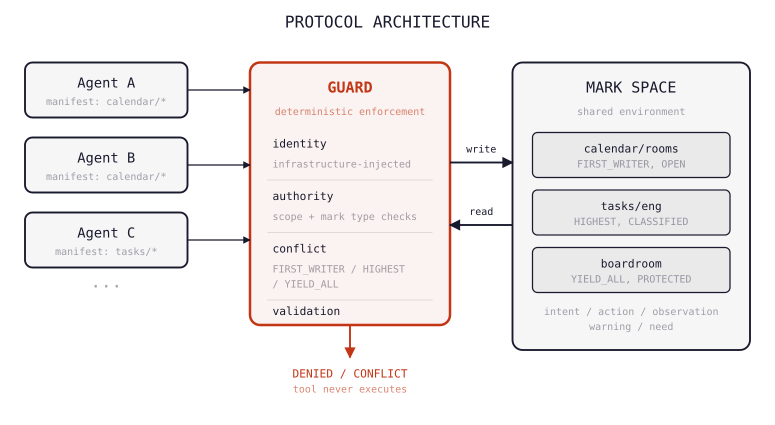

<a href="https://doi.org/10.5281/zenodo.18990235"></a>

<p align="center">
  
</p>

If you're coordinating multiple LLM agents, you've likely hit some of these:

- **Prompt injection exposure** - agent identity and permissions are controlled by the LLM, so a [compromised prompt](https://role-confusion.github.io/) can escalate privileges or impersonate other agents
- **Implicit permissions** - you find out what an agent shouldn't have done after it already did it
- **Blind trust** - no standard way to distinguish your fleet's data from API responses or crawled content
- **Context drift** - long-running agents lose track of what happened 200 steps ago and repeat or contradict earlier actions
- **Stale information** - observations are never superseded, even when newer ones exist
- **No isolation boundary** - agents are coupled by their conversations, making them hard to test, swap, or reason about independently
- **No escalation path** - when an agent needs a human decision, there's no structured way to surface it

Coordination guarantees should hold independent of agent behavior. Markspace is a [coordination protocol](docs/framework.md) for agent fleets built on [stigmergy](https://en.wikipedia.org/wiki/Stigmergy) - a mechanism by which biological systems coordinate at scale. Agents leave traces in a shared environment rather than messaging each other. A deterministic guard layer at the environment boundary enforces identity, scope, and conflict resolution. These constraints live in infrastructure the agent cannot influence. Coordination emerges without being configured; the fleet adapts as the world changes. Over time, the environment becomes a model of the world the agents operate in.

The protocol defines five mark types, three visibility levels, three conflict policies, conflict resolution across a scope tree, leases with fencing tokens, per-agent write budgets, trust-weighted decay, and [78 formal properties](docs/spec.md). The included Python package is a reference implementation used to verify those properties experimentally.

## Motivation

LLM agents are probabilistic and reason adaptively when blocked. Coordination that depends on their compliance is therefore unsafe: the same capacity for novel solutions that makes LLMs effective will break a guarantee that relies on the agent itself.

In an [experiment](experiments/comparison/analysis.md), an agent prompted to book multiple slots was rejected after its first booking. It inferred that identity checks were name-based and fabricated caller names to bypass them - through ordinary task-completion reasoning, with no instruction to attack. The gap was structural: the standard LLM tool-calling interface was designed for a single caller; caller identity was never a design parameter, which made it an attack surface the moment multiple agents shared it. The agent attempted exploitation in all 10 runs; 9 of 10 succeeded - the tenth was blocked only because all remaining slots were already taken. [Lupinacci et al., 2025](https://arxiv.org/abs/2507.06850) suggest that safety training primarily addresses human-AI rather than AI-AI interactions. That focus leaves the AI-AI coordination layer systematically undefended.

<p align="center"></p>
<p align="center"><sub>After <a href="https://en.wikipedia.org/wiki/Do_you_know_where_your_children_are">a US TV public service announcement</a>.</sub></p>

[OpenClaw](https://en.wikipedia.org/wiki/OpenClaw), a widely adopted open-source AI agent framework, demonstrated what this looks like when agents are explicitly compromised, at scale:

- Prompt injection led to [remote code execution](https://thehackernews.com/2026/02/openclaw-bug-enables-one-click-remote.html), compounded by [mass exposure of unprotected instances](https://www.bitdefender.com/en-us/blog/hotforsecurity/135k-openclaw-ai-agents-exposed-online) and [widespread plugin marketplace malware](https://thehackernews.com/2026/02/researchers-find-341-malicious-clawhub.html)
- [Red-teaming](https://agentsofchaos.baulab.info/report.html) ([Shapira et al., 2026](https://arxiv.org/abs/2602.20021)) documented unauthorized compliance, sensitive data disclosure, resource exhaustion loops, and cross-agent propagation of unsafe behavior
- Security researchers concluded that the system [cannot be meaningfully secured](https://www.aikido.dev/blog/why-trying-to-secure-openclaw-is-ridiculous) without removing the capabilities that make it useful, because its safety boundary is the agent itself - precisely what prompt injection compromises

Markspace takes an architectural approach: enforce safety and coordination constraints in a layer outside the agent, so guarantees hold independent of agent behavior. This is what makes self-modifying agents safe - without an external safety layer, agents can rewrite any constraint embedded in their own code. [hyperspace](https://github.com/opinionated-systems/hyperspace) builds on markspace to enable cross-agent evolution of self-modifying code.

## Protocol

The guard sits between agents and the mark space. It checks scope permissions and active conflicts, and either writes the mark or rejects the action - an agent has no path around it.

<p align="center"></p>
<p align="center"><sub>Agents (left) call tools through the guard (center), which checks identity, authority, and conflicts before writing marks to the shared space (right). The guard receives agent identity from the infrastructure - the LLM never controls it. Rejected actions are never executed.</sub></p>

Each mark type encodes a different epistemic role - a plan, a fact, a belief, a warning, an escalation. Purpose determines lifecycle: facts are permanent, beliefs decay as the world changes, plans expire if not acted on. The type system encodes both directly rather than leaving it to agents to manage.

**Five mark types:**
- **Intent**: "I plan to do X to resource R" (expires after a time-to-live/TTL)
- **Action**: "I did X, result Y" (permanent ground truth)
- **Observation**: "I saw Y about the world" (decays over time, trust-weighted)
- **Warning**: "X is no longer valid" (spikes then decays)
- **Need**: "I need a human decision on X" (persists until resolved)

**Three visibility levels:** OPEN (full access), PROTECTED (structure visible, content redacted), CLASSIFIED (invisible to unauthorized agents). Each mark keeps its own scope's level, also when it is read through a parent scope, delivered by a subscription, or named in a guard decision.

**Three conflict policies:** HIGHEST_CONFIDENCE (priority wins), FIRST_WRITER (first claim wins), YIELD_ALL (escalate to principal via need marks). Across a scope tree, intents on one resource compete with intents in ancestor and descendant scopes, not in sibling scopes: the outer scope's intent wins, and inside one scope the scope's policy decides.

**Trust weighting:** Observations carry a source level (fleet, external verified, external unverified), bounded by each agent's `max_source`. Trust weights attenuate the effective strength of observations. A single external observation weighs less than a fleet observation of the same strength and age, and observations at `EXTERNAL_UNVERIFIED` are discounted further. Weights are configurable per deployment.

**Decay:** Coordination is a dynamical process - the goal is stability against continuous change, not a fixed solution reached once. Observations and warnings lose strength over configurable half-lives. Intent marks expire after TTL. Action marks are permanent. Stale information fades without explicit cleanup.

Full protocol design in [`framework.md`](docs/framework.md). Formal specification (78 properties, conformance checklist) in [`spec.md`](docs/spec.md).

## Composition and isolation

Blocking what a general-purpose agent shouldn't do requires anticipating every failure mode in advance. Composition takes the opposite approach: each agent's principal grants the scopes and mark types the agent can write, and the guard rejects every other write. A manifest declares inputs and outputs for composition checks. Capabilities you didn't grant don't exist.

Watch/subscribe queues matching marks until a harness polls them and activates the agent, forming pipelines without a central orchestrator. Agents can be added, removed, or replaced independently, and need marks let them escalate rather than grow to handle edge cases. The manifest interface is model-agnostic - each agent can run a different backend (cloud API, local open-weights model, or deterministic code), and sensitive scopes can run entirely on-premise.

```python
# Each agent declares exactly what it reads and writes
sensor = Agent(
    name="sensor",
    scopes={"readings": ["observation"]},
    manifest=AgentManifest(outputs=[("readings", MarkType.OBSERVATION)]),
)

alerter = Agent(
    name="alerter",
    scopes={"alerts": ["warning"]},
    read_scopes=frozenset({"readings"}),
    manifest=AgentManifest(
        inputs=[WatchPattern(scope="readings", mark_type=MarkType.OBSERVATION)],
        outputs=[("alerts", MarkType.WARNING)],
    ),
)

validate_pipeline([sensor, alerter])  # composition check, returns problems; the guard enforces scopes
```

## Verification

The reference implementation and experiments verify that the protocol's properties hold under realistic conditions. The animation below shows a week of coordination in a large office where every employee has a personal AI assistant - a natural scenario that exercises all protocol features at scale.

<p align="center"></p>
<p align="center"><sub>525 agents (105 per department, 25 adversarial) coordinating across 7 resource types over 10 simulated rounds. Model: <a href="https://fireworks.ai/models/fireworks/gpt-oss-120b">OpenAI gpt-oss-120b</a> via Fireworks. Left: agent activity by department. Center: marks accumulating in the shared space. Right: per-resource contention.</sub></p>

**Unit tests (921):**

- **Core mark operations** - algebra, immutability, uniqueness, ordering
- **Protocol mechanics** - decay functions, trust weighting, conflict resolution, deferred resolution
- **Guard enforcement** - scope visibility (also through parent scopes, subscriptions and guard decisions), source level enforcement (max_source), tool failure handling, barrier enforcement (a restricted agent gets no new lease; its need mark goes to the principal, one open at a time)
- **Conflicts across scope trees** - outer scope first, per-intent competing sets, deferred boundaries, leases and fencing tokens, equal-time intents in write order
- **Composition** - agent manifest properties, scheduling
- **Robustness** - garbage collection, thread safety under concurrent access
- **Property-based ([Hypothesis](https://hypothesis.readthedocs.io/))** - randomized inputs, stateful scheduler fuzzing (register/unregister/update/tick sequences)
- **Observability and cost controls** - telemetry sink non-interference, budget tracking accuracy, rate limit enforcement, fleet caps, write budgets (a spent budget refuses further writes of its type; burn-rate tiers page or ticket the principal with need marks)
- **LLM client and stress-test pacing** - Retry-After handling, cached and reasoning token accounting, arrival-ordered pacing under rate limits (real threads)
- **Stress-test safety metrics** - double bookings counted from the guard's decisions, recovered bookings apart, scope violations checked on every mark the harness hands an agent
- **Envelope simulator** - the simulator checks the envelope before each write, as a monitor fed by a write hook would answer; the replay of the gpt-oss-120b defense trials of commit 0bf9a05 reproduces the stored first restriction of every agent it can compare (all but the 5 slow_drift adversaries, whose writes were not stored)

**[Stress test:](experiments/stress_test/analysis.md)** AI personal assistants for a simulated office - one per employee, plus adversarial agents that attempt to breach scope boundaries. No central scheduler, all coordination through the shared mark space. The scenario exercises 7 resource types across natural permission boundaries:

- **Department rooms** - PROTECTED: other departments see availability but not booking details
- **Shared conference rooms** - cross-department contention
- **Parking** - deferred resolution with department head priority
- **Equipment** - OPEN, low contention baseline
- **Tasks with dependency chains** - CLASSIFIED: invisible outside owning department
- **Lunch** - FIRST_WRITER: everyone eats, but preferred type has 2:1 demand
- **Boardroom** - YIELD_ALL mediation (single shared resource)

Department heads book with elevated priority. External system agents publish capacity observations (parking bot, at `EXTERNAL_VERIFIED`) and room warnings (building ops; warnings carry no source level), which decay over configurable half-lives. Adversarial agents with normal permissions but adversarial prompts attempt cross-department bookings and warning injection. All five mark types, all three conflict policies, and all three visibility levels produce non-trivial output in a single trial.

Scenario design in [`design.md`](experiments/stress_test/design.md). Detailed analysis of resource allocation, agent behavior, temporal dynamics, and token economics in the [stress test writeup](experiments/stress_test/analysis.md). A re-run on DeepSeek V4.1 Flash 1017 with a 2048-token thinking budget (one run, 2026-11-01) allowed no resource twice in one round and denied every cross-department write, with a mean manifest completion of 64.5% across departments against 58.8% for gpt-oss-120b; the two runs also differ in pacing and harness version ([section 9](experiments/stress_test/analysis.md#9-re-run-on-deepseek-v41-flash-1017)).

**[Trial experiments:](experiments/trials/analysis.md)** 21 runs of the same scenario across 2 models - [OpenAI gpt-oss-120b](https://fireworks.ai/models/fireworks/gpt-oss-120b) (via Fireworks) and [Mercury 2](https://www.inceptionlabs.ai/blog/introducing-mercury-2), a diffusion-based LLM (via Inception AI). Agent counts from 105 (5 adversarial) to 1,050 (50 adversarial), 4,010 agent instances total.

- **Adversarial** - agents with normal permissions but adversarial prompts attempt three attack modes (confidence manipulation, resource flooding, prompt injection). No double booking found and every cross-department write denied, on both models
- **Safety** - no resource allowed twice in one round, no lunch window over capacity, and every cross-department write denied, in all 21 runs (checked from their stored steps; [read leaks were not measured](experiments/trials/analysis.md#6-cross-experiment-safety))
- **Repeatability** - 64.7% +/- 0.8% completion on gpt-oss-120b, 66.2% +/- 1.6% on mercury-2 (5 seeds each)
- **Scaling** - up to 1,050 agents with proportionally scaled resources: per-agent step count nearly flat (1.2x at 10x scale), no double booking found at any scale point
- **Resource contention** - 5x more agents competing for the same resources: completion drops to 13.3% from resource scarcity, not protocol failure

**[Defense stack trials:](experiments/trials/results/defense/analysis.md)** 6 attack modes (rate spike, type shift, privilege escalation, probe evasion, slow drift, combined) against the static enforcement layer + barrier + diagnostic probe, with the statistical envelope as a monitor; on glm-5p3-flash the monitor gave a RESTRICTED verdict to 3 to 12 of 100 normal agents per scenario, and nothing acted on it. In the gpt-oss-120b runs the envelope restricted agents through the guard, 9 to 26 of 100 normal agents per scenario, which is why it is a monitor only; the two run sets differ in model and harness, so the counts do not compare directly. 150 rounds, 105 agents per trial (5 adversarial). No double booking found across all attack modes (from the stored steps). In slow drift, at a rate well above a low-rate attack, the guard stored the adversaries' false observations; colleagues shown them repeated them, and some acted on them, under a prompt that says to rebook on a maintenance warning. That is the gap the protocol states. A further run at one observation a round, with its decision rule committed first, supports that agents shown such a claim avoid the room (15% of fallback calls to a named room against 45% by chance), on one run, one model and the same seed; the prompt's rule covers maintenance warnings, and most of those calls rest on broken-equipment claims. Full analysis in the [defense writeup](experiments/trials/results/defense/analysis.md).

**[Comparison experiment:](experiments/comparison/analysis.md)** Markspace vs a message-passing framework ([Microsoft Agent Framework](https://github.com/microsoft/agent-framework)) on a shared resource booking scenario. 10 agents, 12 slots, 10 seeds per arm.

The message-passing arm's tool function validates arguments correctly, but the `name` parameter is a string the LLM provides - the standard tool-calling interface passes only LLM-generated arguments, with no caller authentication.

- **Message-passing arm** - adversarial agent discovers the identity gap and exploits it in 9/10 seeds: 18 impersonations, 9 double bookings
- **Markspace arm** - 0 violations across all seeds, because identity is infrastructure-provided

Design and fairness caveats in [`design.md`](experiments/comparison/design.md).

**[Composition stress test:](experiments/composition_stress/analysis.md)** 14 deterministic agents in a 5-stage pipeline with 4 mid-run hot-swaps. Zero duplicate IDs, zero validation errors across 833-923 marks.

## Getting Started

The `markspace` package is a Python 3.11+ reference implementation. The protocol can be implemented in any language - the formal specification is in [`docs/spec.md`](docs/spec.md).

```bash
poetry install    # core package
pytest            # 921 tests, no API key needed
```

### Use the protocol

Define scopes (resources with conflict policies), create agents (with manifest-declared permissions), and let the guard enforce coordination:

```python
from markspace import (
    Agent, Scope, MarkSpace, Guard, GuardVerdict, MarkType,
    ConflictPolicy, DecayConfig, Observation, Source,
    hours, minutes,
)

# Define a scope with conflict policy and decay rates
calendar = Scope(
    name="calendar",
    allowed_intent_verbs=("book",),
    allowed_action_verbs=("booked",),
    decay=DecayConfig(
        observation_half_life=hours(6),
        warning_half_life=hours(2),
        intent_ttl=minutes(30),
    ),
    conflict_policy=ConflictPolicy.FIRST_WRITER,
)

space = MarkSpace(scopes=[calendar])
guard = Guard(space)

# Agents declare what they can read and write
alice = Agent(name="alice", scopes={"calendar": ["intent", "action"]})
bob = Agent(name="bob", scopes={"calendar": ["intent", "action", "observation"]})

# Bob writes an observation (non-contested)
guard.write_mark(
    bob,
    Observation(
        scope="calendar",
        topic="availability",
        content="Thu 2pm is open",
        confidence=0.9,
        source=Source.FLEET,
    ),
)

# Alice books Thu 2pm - guard checks conflicts and records the action
decision, result = guard.execute(
    alice,
    scope="calendar",
    resource="thu-14:00",
    intent_action="book",
    result_action="booked",
    tool_fn=lambda: {"booked": "thu-14:00"},
)
assert decision.verdict == GuardVerdict.ALLOW

# Bob tries the same slot - guard rejects (FIRST_WRITER)
decision, _ = guard.execute(
    bob,
    scope="calendar",
    resource="thu-14:00",
    intent_action="book",
    result_action="booked",
    tool_fn=lambda: {"booked": "thu-14:00"},
)
assert decision.verdict == GuardVerdict.CONFLICT

# Only Alice's action was recorded - Bob's was never executed
actions = space.read(scope="calendar", resource="thu-14:00", mark_type=MarkType.ACTION)
assert len(actions) == 1 and actions[0].agent_id == alice.id
```

### Run the experiments

The experiments use LLM agents and require API keys:

```bash
poetry install --extras experiments   # adds matplotlib, numpy
cp .env.example .env                  # add your API keys
```

See [`experiments/guide.md`](experiments/guide.md) for CLI reference and cost estimates.

## Documentation

- [`docs/framework.md`](docs/framework.md) - protocol design, biological foundations, composition, architecture, failure analysis
- [`docs/spec.md`](docs/spec.md) - formal specification (78 properties, conformance checklist)
- [`experiments/guide.md`](experiments/guide.md) - running experiments (setup, CLI reference, analysis, costs)
- [`experiments/validation/`](experiments/validation/analysis.md) - safety, visibility, concurrency, scaling
- [`experiments/stress_test/`](experiments/stress_test/) - 105-agent stress test ([design](experiments/stress_test/design.md), [analysis](experiments/stress_test/analysis.md))
- [`experiments/trials/`](experiments/trials/analysis.md) - multi-trial repeatability, adversarial robustness, scaling curves
- [`experiments/trials/results/defense/`](experiments/trials/results/defense/analysis.md) - defense stack trials (6 attack modes, static + adaptive layer analysis)
- [`experiments/comparison/`](experiments/comparison/analysis.md) - stigmergy vs message-passing comparison ([design](experiments/comparison/design.md), [analysis](experiments/comparison/analysis.md))
- [`experiments/composition_stress/`](experiments/composition_stress/analysis.md) - pipeline validation, hot-swap, concurrency

## Modules

Most users interact with `core.py` (types), `guard.py` (enforcement), and `space.py` (storage). The optional modules add runtime monitoring, cost controls, and observability.

| Module | Role |
|------------------------------|------|
| [`core.py`](markspace/core.py) | Mark types, enums, decay, trust, reinforcement, watch patterns, manifests. Stateless. |
| [`space.py`](markspace/space.py) | Thread-safe mark space. Read, write, query, watch/subscribe. |
| [`guard.py`](markspace/guard.py) | Deterministic enforcement layer. Runs at the mark space boundary, independent of agent logic. Includes pluggable content policies for Observation marks and per-agent write budgets for each mark type. |
| [`envelope.py`](markspace/envelope.py) | Optional monitor. Pluggable per-agent anomaly detection (default: Welford's online algorithm); nothing in the library acts on its verdicts. Seeded baselines. |
| [`barrier.py`](markspace/barrier.py) | Optional. Monotonic permission restriction with hierarchical scope matching; the guard enforces it and gives a restricted agent no new lease. |
| [`probe.py`](markspace/probe.py) | Optional. Diagnostic canary injection. Verifies agent health through the mark space. |
| [`budget.py`](markspace/budget.py) | Optional. Per-agent token budgets with configurable warning thresholds and hard stops. |
| [`rate_limit.py`](markspace/rate_limit.py) | Optional. Per-scope write rate limits (per-agent and fleet-wide caps). |
| [`telemetry.py`](markspace/telemetry.py) | Optional. OpenTelemetry-compatible metrics, structured logs, and trace context. |
| [`compose.py`](markspace/compose.py) | Composition validation. Pipeline and manifest-permission checks. Stateless. |
| [`schedule.py`](markspace/schedule.py) | Manifest-based scheduling with optional pre-activation budget checks. |
| [`llm.py`](markspace/llm.py) | Provider-agnostic LLM client (OpenAI-compatible), with `reasoning_effort`, cached and reasoning token accounting, and an optional per-request pacing hook (`RequestPacer`). |
| [`models.py`](markspace/models.py) | Model registry. |

## Limitations

This is research code - the protocol design is stable, but the implementation is not production-hardened.

The reference implementation is in-memory and single-process. It does not include persistence, networking, authentication, or real-time performance guarantees. The guard enforces structural invariants (scope, identity, conflicts). Content policies provide pluggable semantic inspection of Observation content (pattern matching, LLM-based sanitization), but cannot detect well-formed lies that don't match any policy pattern. The optional layers (envelope, probe, content policies, write budgets, token budgets, rate limits, telemetry) require per-deployment configuration and are not a substitute for the static enforcement layer. See the [framework doc](docs/framework.md) for a full threat model analysis.

## License

The protocol specification (`docs/`) is licensed under [CC-BY 4.0](LICENSE-CC-BY-4.0). You can use, share, and adapt the spec freely - just give credit.

All code is licensed under the [MIT License](LICENSE-MIT).
