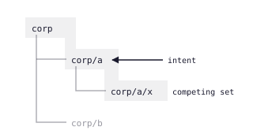
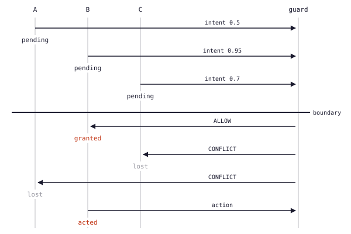
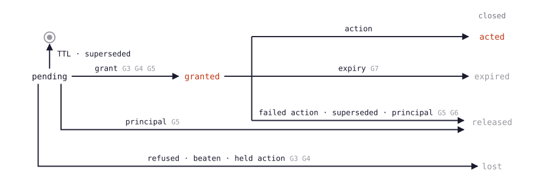
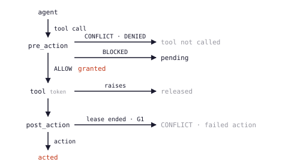

# Markspace Coordination Protocol: Specification

**Version**: 2026-11-02-draft
**Status**: Working draft

This document is the formal specification for the markspace protocol. For the ideas and the motivation behind the protocol, read [framework.md](framework.md).

## Contents

- [Abstract](#abstract)
- [1. Terminology](#1-terminology)
- [2. Mark Types](#2-mark-types)
  - [2.1 Common Fields](#21-common-fields)
  - [2.2 Intent](#22-intent)
  - [2.3 Action](#23-action)
  - [2.4 Observation](#24-observation)
  - [2.5 Warning](#25-warning)
  - [2.6 Need](#26-need)
- [3. Decay](#3-decay)
  - [3.1 Decay Rules](#31-decay-rules)
  - [3.2 Formal Properties](#32-formal-properties)
- [4. Trust](#4-trust)
  - [4.1 Source Levels](#41-source-levels)
  - [4.2 Effective Strength](#42-effective-strength)
  - [4.3 Formal Properties](#43-formal-properties)
- [5. Reinforcement](#5-reinforcement)
  - [5.1 Combination Rule](#51-combination-rule)
  - [5.2 Grouping](#52-grouping)
  - [5.3 Formal Properties](#53-formal-properties)
- [6. Conflict Resolution](#6-conflict-resolution)
  - [6.1 Resolution Protocol](#61-resolution-protocol)
  - [6.2 Deferred Resolution](#62-deferred-resolution)
  - [6.3 Post-Action Resolution](#63-post-action-resolution)
  - [6.4 Formal Properties](#64-formal-properties)
  - [6.5 Grants](#65-grants)
- [7. Scope](#7-scope)
  - [7.1 Scope Definition](#71-scope-definition)
  - [7.2 DecayConfig](#72-decayconfig)
  - [7.3 Scope Authorization](#73-scope-authorization)
  - [7.4 Scope Visibility](#74-scope-visibility)
  - [7.5 Hierarchical Scopes](#75-hierarchical-scopes)
  - [7.6 Formal Properties](#76-formal-properties)
- [8. Mark Space](#8-mark-space)
  - [8.1 Write](#81-write)
  - [8.2 Read](#82-read)
  - [8.3 Resolve](#83-resolve)
  - [8.4 Aggregate Needs](#84-aggregate-needs)
  - [8.5 Formal Properties](#85-formal-properties)
  - [8.6 Write Hooks](#86-write-hooks)
- [9. Guard](#9-guard-deterministic-enforcement-layer)
  - [9.1 Principle](#91-principle)
  - [9.2 Guard Operations](#92-guard-operations)
  - [9.3 GuardDecision](#93-guarddecision)
  - [9.4 What the Agent Still Does](#94-what-the-agent-still-does)
  - [9.5 Warning Invalidation](#95-warning-invalidation)
  - [9.6 Formal Properties](#96-formal-properties)
  - [9.7 Statistical Envelope](#97-statistical-envelope)
  - [9.8 Absorbing Barrier](#98-absorbing-barrier)
  - [9.9 Diagnostic Probe](#99-diagnostic-probe)
  - [9.10 Token Budgets](#910-token-budgets)
  - [9.11 Telemetry](#911-telemetry)
  - [9.12 Scope Rate Limits](#912-scope-rate-limits)
  - [9.13 Content Policies](#913-content-policies)
  - [9.14 Write Budgets](#914-write-budgets)
- [10. Generalized Supersession](#10-generalized-supersession)
  - [10.1 Formal Properties](#101-formal-properties)
- [11. Agent](#11-agent)
  - [11.1 Agent Definition](#111-agent-definition)
  - [11.2 Agent-Local Rules](#112-agent-local-rules)
  - [11.3 Agent Manifests](#113-agent-manifests)
- [12. Reference Implementation](#12-reference-implementation)
  - [12.1 DSL Usage](#121-dsl-usage)
- [13. Agent Composition](#13-agent-composition)
  - [13.1 Watch Patterns](#131-watch-patterns)
  - [13.2 Agent Manifests](#132-agent-manifests)
  - [13.3 Subscription](#133-subscription)
  - [13.4 Watched Marks](#134-watched-marks)
  - [13.5 Composition Validation](#135-composition-validation)
  - [13.6 Formal Properties](#136-formal-properties)
- [14. Scheduling](#14-scheduling)
  - [14.1 Schedule Configuration](#141-schedule-configuration)
  - [14.2 Scheduler](#142-scheduler)
  - [14.3 Formal Properties](#143-formal-properties)
- [15. Properties Summary](#15-properties-summary)
- [16. Conformance](#16-conformance)

## Abstract

This document specifies a coordination protocol for fleets of autonomous agents. The agents coordinate indirectly, through marks that they leave in a shared environment (stigmergy). The protocol defines five mark types, the lifecycle semantics of these mark types, and the operations that agents do on the marks. An implementation that conforms to this specification lets N agents coordinate without direct communication, a central scheduler or consensus protocols.

A Python reference implementation and property tests accompany this specification. Every normative statement (MUST, SHOULD, MAY) maps to an executable test. The reference implementation shows that these properties hold together consistently. Any language can reimplement it, if the new implementation satisfies the same test suite.

**Verification level.** Python property-based tests (pytest + [Hypothesis](https://github.com/HypothesisWorks/hypothesis)) verify the 47 mandatory properties (P1-P39, P42, P47 and P71-P76) empirically. The verification does not use formal model checking (for example, [MCMAS](https://doi.org/10.1007/s10009-015-0378-x), [PRISM](https://doi.org/10.1007/978-3-642-22110-1_47) or [TLA+](https://lamport.azurewebsites.net/tla/tla.html)). The tests apply randomized inputs and edge cases to each property.

The [stress test](../experiments/stress_test/analysis.md) tests P1-P39 and P47 under a realistic concurrent load. Its stored runs are older than P71-P76. It uses up to 1,050 agents across 20 rounds, with adversarial participants. The [trial results](../experiments/trials/analysis.md) show no double booking across all 21 trial runs and 4,010 agent instances (from their stored steps).

This evidence gives high confidence that the properties hold in practice. It is not a formal proof. A formal verification effort would make the safety guarantees stronger, particularly for P11 (Determinism) and P12 (Progress). These two properties make claims about all possible states.

## 1. Terminology

In this document, the key words "MUST", "MUST NOT", "REQUIRED", "SHALL", "SHALL NOT", "SHOULD", "SHOULD NOT", "RECOMMENDED", "MAY", and "OPTIONAL" have the meanings that [RFC 2119](https://www.rfc-editor.org/rfc/rfc2119) describes.

**Mark**: A typed record that an agent writes to a shared space. The mark is the basic unit of coordination.

**Mark Space**: The shared environment that stores the marks. Agents interact only through the mark space. Agents never interact directly with each other.

**Agent**: An autonomous process with an identity and a set of scope permissions. Agents read and write marks. Agents do not communicate with other agents.

**Scope**: A namespace that defines the kinds of marks that can exist in it, their decay parameters and the conflict resolution rules.

**Strength**: A non-negative real number that represents the current influence of a mark. An implementation computes it at read time from the initial strength, age, decay function and source level of the mark (observations only).

**Principal**: The human (or system) that the agents serve. To interact with the system, the principal writes action marks that resolve needs.

**Freshness**: The component of strength that depends on time. All marks except actions and unresolved needs decay over time.

## 2. Mark Types

There are exactly five mark types. An implementation MUST support all five. An implementation MUST NOT define additional mark types at the protocol level. (Scope definitions, not new mark types, express domain-specific semantics.)

### 2.1 Common Fields

All definitions in this specification use [Protocol Buffers proto3](https://protobuf.dev/programming-guides/proto3/) syntax in the `markspace` package.

Every mark MUST contain:

```protobuf
syntax = "proto3";

package markspace;

import "google/protobuf/struct.proto";

enum MarkType {
  INTENT      = 0;
  ACTION      = 1;
  OBSERVATION = 2;
  WARNING     = 3;
  NEED        = 4;
}

message Mark {
  string          id               = 1;  // UUID, assigned by the mark space on write
  MarkType        mark_type        = 2;
  string          agent_id         = 3;  // UUID
  string          scope            = 4;  // scope namespace this mark belongs to
  double          created_at       = 5;  // unix timestamp
  double          initial_strength = 6;  // default 1.0, MUST be in [0.0, 1.0]
  optional string supersedes       = 7;  // MAY: UUID of a prior mark this replaces (Section 10)
}
```

Ref: [`markspace/core.py::Mark`](../markspace/core.py)

### 2.2 Intent

An intent mark declares that an agent plans to act on a resource.

Additional fields (all MUST):

```protobuf
message IntentMark {
  Mark   base       = 1;
  string resource   = 2;  // the resource the agent intends to modify
  string action     = 3;  // planned action (must be in scope's intent actions)
  float  confidence = 4;  // [0.0, 1.0] how committed the agent is
}
```

**Lifecycle**:
- An intent mark MUST have a TTL that the scope defines.
- The strength of an intent mark MUST become 0 (the mark is removed) when its TTL expires.
- When the agent does the planned action, a corresponding action mark SHOULD supersede the intent mark.
- An intent mark that no action mark follows before its TTL expires shows that the agent abandoned the plan. No cleanup is necessary. The expiry does the cleanup.
- Before an agent can act on its intent, the guard gives the intent a **lease** (Section 6.5). A lease is the right to use the resource for a limited time. Until the guard gives the lease, the intent waits. The guard can also reject the intent.
- The lease ends when one of these events occurs:
  - The mark space records the agent's action.
  - The agent's tool fails.
  - The agent supersedes the intent with a mark that is not an action.
  - The principal ends the lease.
  - The lease expires.
- The guard keeps its leases in its own lease table, not as marks. An agent that reads the mark space does not see the leases. A lease can last longer than its intent mark.

**Conflict semantics**: See [Section 6](#6-conflict-resolution).

Ref: [`markspace/core.py::Intent`](../markspace/core.py)

### 2.3 Action

An action mark records that an agent did something. Actions are facts.

Additional fields:

```protobuf
message ActionMark {
  Mark                     base       = 1;
  optional string          resource   = 2;  // MAY: the resource that was modified
  string                   action     = 3;  // MUST: what was done
  google.protobuf.Struct   result     = 4;  // MUST: outcome of the action
  bool                     failed     = 5;  // MAY: true when the tool threw an exception
  // Note: supersedes is on the base Mark (field 7), not duplicated here.
  // All mark types support supersession (Section 10).
}
```

**Lifecycle**:
- Action marks MUST NOT decay. Their strength is constant for all time.
- Action marks are historical facts. They are the ground truth of the system.
- An action mark MAY supersede a prior mark (an action or an intent). The effective strength of a superseded mark becomes 0.
- An action mark with `failed = true` records that the tool threw an exception. Failed actions MUST NOT claim the resource. The guard treats failed actions as non-blocking, so other agents can proceed ([Section 9](#9-guard-deterministic-enforcement-layer)).

Ref: [`markspace/core.py::Action`](../markspace/core.py)

### 2.4 Observation

An observation mark records something that an agent perceived about the world.

Additional fields (all MUST):

```protobuf
enum Source {
  FLEET               = 0;
  EXTERNAL_VERIFIED   = 1;
  EXTERNAL_UNVERIFIED = 2;
}

message ObservationMark {
  Mark                   base       = 1;
  string                 topic      = 2;  // what was observed
  google.protobuf.Struct content    = 3;  // the observation itself
  float                  confidence = 4;  // [0.0, 1.0]
  Source                 source     = 5;
}
```

**Lifecycle**:
- Observation marks MUST decay over time, as the scope's `observation_half_life` specifies.
- Decay MUST be exponential: `strength(t) = initial_strength * 0.5^(age / half_life)`.
- An implementation MAY garbage collect an observation mark with strength below a threshold (RECOMMENDED: 0.01).

**Reinforcement**: Multiple observation marks on the same scope and topic combine through the reinforcement function ([Section 5](#5-reinforcement)). Independent observations that agree make the signal stronger.

Ref: [`markspace/core.py::Observation`](../markspace/core.py)

### 2.5 Warning

A warning mark declares that a previous mark or assumption is no longer valid.

Additional fields:

```protobuf
enum Severity {
  INFO     = 0;
  CAUTION  = 1;
  CRITICAL = 2;
}

message WarningMark {
  Mark            base        = 1;
  optional string invalidates = 2;  // MAY: UUID of the mark being contradicted
  string          topic       = 3;  // MUST: what the warning is about
  string          reason      = 4;  // MUST: why the prior information is invalid
  Severity        severity    = 5;  // MUST
}
```

**Lifecycle**:
- Warning marks MUST decay over time with a shorter half-life than observations (RECOMMENDED: the scope's `warning_half_life`, typically < `observation_half_life`).
- Decay MUST be exponential, with the same formula as for observations.
- A warning mark that references `invalidates` MUST reduce the effective strength of the target mark. The reduction is equal to the current strength of the warning.

Ref: [`markspace/core.py::Warning`](../markspace/core.py)

### 2.6 Need

A need mark requests input from the principal.

Additional fields:

```protobuf
message NeedMark {
  Mark                   base        = 1;
  string                 question    = 2;  // MUST: what input is needed
  google.protobuf.Struct context     = 3;  // MUST: information relevant to the question
  float                  priority    = 4;  // MUST: [0.0, 1.0] urgency
  bool                   blocking    = 5;  // MUST: whether the agent is blocked waiting
  optional string        resolved_by = 6;  // MAY: UUID of the action mark that resolved this
}
```

**Lifecycle**:
- Unresolved need marks (resolved_by is None) MUST NOT decay. They keep full strength for an unlimited time.
- Resolved need marks (resolved_by is set) MUST immediately have strength 0.
- A need mark becomes resolved when the principal writes an action mark scoped to the need.

Ref: [`markspace/core.py::Need`](../markspace/core.py)

## 3. Decay

Decay is the mechanism that keeps the mark space current. It is the stigmergic equivalent of pheromone evaporation. The exponential decay model has a theoretical basis in the [Age of Information](https://doi.org/10.1109/ISIT.2012.6283535) (AoI) literature (Kaul et al., 2012). This literature shows that monotonically decreasing freshness functions are optimal for status-update systems.

### 3.1 Decay Rules

An implementation MUST compute mark strength at **read time**, not at write time. Marks stay unchanged in storage. The effective strength of a mark is a pure function of the properties of the mark and the current time.

```
strength(mark, now) → float
```

The function MUST satisfy:

| Mark Type | Decay Rule |
|-----------|------------|
| `intent` | Full strength until TTL, then 0. Step function. |
| `action` | Constant (non-superseded). `strength(t) = initial_strength` for all t. Superseded actions have effective strength 0 (Section 10). |
| `observation` | Exponential. `strength(t) = initial * 0.5^(age / half_life)` |
| `warning` | Exponential. Same formula, with the scope's `warning_half_life`. |
| `need` | Full strength while unresolved. 0 when resolved. Step function. |

Ref: [`markspace/core.py::compute_strength`](../markspace/core.py)

### 3.2 Formal Properties

**P1: Decay Monotonicity**: For observation and warning marks, strength MUST be a monotonically non-increasing function of time. For all `t2 > t1`: `strength(mark, t2) <= strength(mark, t1)`.

**P2: Action Permanence**: For non-superseded action marks, base strength MUST be constant. For all `t1, t2`: `compute_strength(action_mark, t1) == compute_strength(action_mark, t2)`. The effective strength of a superseded action is 0 (Section 10). Its base strength does not change. Supersession changes whether the action is visible, not the underlying record.

**P3: Convergence**: If the mark space receives no new marks, the total strength of all its transient marks MUST converge to 0 as t -> infinity. The transient marks are the observations and the warnings.

**P4: Intent Expiry**: The strength of an intent mark MUST be 0 for all `t > created_at + ttl`.

**P5: Need Persistence**: The strength of an unresolved need mark MUST equal its initial strength for all t.

Ref: [`tests/test_properties.py::TestP1DecayMonotonicity`](../tests/test_properties.py), [`tests/test_properties.py::TestP2ActionPermanence`](../tests/test_properties.py), [`tests/test_properties.py::TestP3Convergence`](../tests/test_properties.py), [`tests/test_properties.py::TestP4IntentExpiry`](../tests/test_properties.py), [`tests/test_properties.py::TestP5NeedPersistence`](../tests/test_properties.py)

## 4. Trust

Trust is a weight that depends on the source of a mark. An implementation applies the trust weight when it computes the effective strength of a mark.

### 4.1 Source Levels

There are three source levels, in a strict total order:

```
fleet  >  external_verified  >  external_unverified
```

An implementation MUST assign trust weights that preserve this order. The RECOMMENDED weights are:

| Source | Weight |
|--------|--------|
| `fleet` | 1.0 |
| `external_verified` | 0.7 |
| `external_unverified` | 0.3 |

### 4.2 Effective Strength

The effective strength of a mark includes both decay and trust:

```
effective_strength(mark, now) = compute_strength(mark, now) * trust_weight(mark.source)
```

For mark types that do not have a `source` field (intent, action, warning, need), the trust weight MUST be 1.0. This holds for every agent, also for an agent with a lower `max_source` ([Section 11.1](#111-agent-definition)): `max_source` bounds observations only.

### 4.3 Formal Properties

**P6: Trust Ordering**: If two marks have identical properties except their source, the mark with the higher source level MUST have a higher effective strength. For all t: `effective_strength(fleet_mark, t) >= effective_strength(verified_mark, t) >= effective_strength(unverified_mark, t)`.

**P7: Trust Bounds**: Effective strength MUST be in [0.0, max_strength * 1.0]. The trust weight MUST NOT increase strength above the base decay value.

Ref: [`markspace/core.py::trust_weight`](../markspace/core.py), [`tests/test_properties.py::TestP6TrustOrdering`](../tests/test_properties.py), [`tests/test_properties.py::TestP7TrustBounds`](../tests/test_properties.py)

## 5. Reinforcement

When multiple marks exist on the same scope and topic, they combine into an aggregate signal. The reinforcement function is a utility. `read()` returns individual marks with their effective strengths. A caller that wants an aggregate signal calls `reinforce()` on the returned strengths. This separation keeps reads simple and lets callers choose whether to aggregate. `reinforce()` counts marks, not writers. A caller that wants agreement between independent writers to count gives it at most one observation for each writer. Otherwise the repeated observations of one writer raise the aggregate as the observations of many writers would.

### 5.1 Combination Rule

Reinforcement MUST be **sublinear**. N identical marks MUST produce an aggregate strength less than N times the strength of a single mark. This rule prevents a flood of marks.

The RECOMMENDED combination is:

```
Given marks [m1, m2, ..., mn] on the same scope+topic, sorted by effective_strength descending:

  aggregate = effective_strength(m1)
  for each subsequent mi:
    aggregate += effective_strength(mi) * REINFORCEMENT_FACTOR

  return min(aggregate, REINFORCEMENT_CAP)
```

Where:
- `REINFORCEMENT_FACTOR` MUST be in (0.0, 1.0). RECOMMENDED: 0.3.
- `REINFORCEMENT_CAP` MUST be finite. RECOMMENDED: 2.0 * max_single_mark_strength.

### 5.2 Grouping

Reinforcement groups marks by these keys:
- Observations and warnings: `(scope, topic)`.
- Intents and actions: `(scope, resource)`.

Reinforcement does not apply to need marks (each need is unique to an agent).

### 5.3 Formal Properties

**P8: Sublinearity**: For N identical marks, `aggregate_strength(N marks) < N * single_mark_strength` for all N > 1.

**P9: Boundedness**: `aggregate_strength(any number of marks) <= REINFORCEMENT_CAP`.

**P10: Monotonic Addition**: The addition of a mark with positive strength MUST NOT decrease the aggregate strength. `aggregate_strength(marks + [new_mark]) >= aggregate_strength(marks)` when `effective_strength(new_mark) > 0`.

Ref: [`markspace/core.py::reinforce`](../markspace/core.py), [`tests/test_properties.py::TestP8Sublinearity`](../tests/test_properties.py), [`tests/test_properties.py::TestP9Boundedness`](../tests/test_properties.py), [`tests/test_properties.py::TestP10MonotonicAddition`](../tests/test_properties.py), [`tests/test_hypothesis.py::TestReinforcementProperties`](../tests/test_hypothesis.py)

## 6. Conflict Resolution

A conflict exists when two or more agents write intent marks on the same resource in the same scope. A conflict also exists when the intent marks are in two scopes and one scope contains the other (`corp` and `corp/merger`). Sibling scopes (`corp/a` and `corp/b`) do not compete.

The **competing set** of an intent is every active intent on the resource in its own scope, its ancestors and its descendants. In this section and in Section 9, `(scope, resource)` means that set. Competition is not transitive. For example, `corp/a` and `corp/b` both compete with `corp`, but they do not compete with each other. Thus the judgment of each intent uses its own competing set (Section 6.1).

<p align="center"></p>

Conflict resolution is deterministic. The guard decides from the marks and from its own lease table (Section 6.5). The lease table records which intents can act now, and which intents the guard rejected. An agent that reads only the marks can predict the decision of the guard. But the lease table is not part of the mark space. Thus that agent cannot tell an intent that holds a lease from an intent that waits.

### 6.1 Resolution Protocol

When an agent reads intent marks on a resource that it also intends to change, the agent does these steps:

1. Collect the competing set of the intent: all active intent marks (strength > 0) on `(scope, resource)`.
2. If there are no other intents and no lease of another agent, proceed.
3. If other intents exist, compare the intent with each of them. Use these rules for each pair:
   - If one or both scopes of the pair use YIELD_ALL, the pair goes to the principal (see YIELD_ALL below). But if another competitor beats the intent, the intent loses instead.
   - Otherwise, the intent in the outer scope wins. The outer scope is the scope that contains the other scope.
   - If the two intents are in one scope, the policy of that scope decides.

   The intent proceeds only if it wins every comparison.

Each win goes to the intent in the outer scope, or follows the order of one scope. Thus the wins never make a cycle. This has these results:

- No decision allows two competing intents.
- The outcome of an intent does not depend on which scope's decision computes it.
- If X beats a competitor of the intent, and that competitor beats the intent, then X also competes with the intent and beats it.

Inside one scope, these comparisons give the same result as one application of the policy of the scope to the whole set.

An implementation MAY judge a whole set at once. Every intent in an outer scope beats every intent below it, unless one or both scopes are YIELD_ALL. Thus one sort of the intents of each scope, by the policy of that scope, gives the outcome of every intent. This method follows multiple-granularity locking ([Gray, Lorie, Putzolu, Traiger, 1976](https://core.ac.uk/works/16970558)). The judgment of a beaten intent names the first intent of the outermost scope that beats it.

In this section, an intent, a lease or an action **blocks** an intent when it prevents a grant to that intent. This is not the verdict BLOCKED.

This order has these consequences:

- Among waiting claims, an intent in an outer scope pre-empts the intents in inner scopes. The order and the confidence of the intents do not change this result.
- Nothing pre-empts a granted claim. A guard grants a lease to the winning intent (Section 6.5). An intent that would beat the live lease of another agent waits until that lease ends, or it yields.
- An intent cannot proceed if its competing set holds a completed action of another agent (P39). The guard closes this intent permanently. Thus this intent blocks no other intent.

These are the policies:

**FIRST_WRITER**: The intent with the earliest `created_at` wins. All other agents MUST yield.

**HIGHEST_CONFIDENCE**: The intent with the highest `confidence` wins. If two intents have the same confidence, the intent with the earliest `created_at` wins. The agents that lose MUST yield.

**YIELD_ALL**: Each agent whose intent goes to the principal (step 3) MUST write a need mark that requests a resolution from the principal. If another competitor beats an intent, that intent loses, and its agent writes no need mark. No agent of such a pair proceeds until the principal decides.

"Yield" means that the agent MUST NOT write an action mark on the contested resource. The agent MAY do any of these:

- Write a new intent on a different resource.
- Wait until the winning claim ends, and then try again.
- Write a need mark.

### 6.2 Deferred Resolution

Lock-based guards ([Section 9](#9-guard-deterministic-enforcement-layer)) serialize access. In each scope, at most one agent at a time enters `pre_action`. With serialized access, HIGHEST_CONFIDENCE becomes the same as FIRST_WRITER. The cause is that the second agent finds an action that is already committed, not a competing intent. The guard returns CONFLICT (resource taken), and it never does the confidence comparison.

This is [priority inversion](https://www.cs.cornell.edu/courses/cs614/1999sp/papers/pathfinder.html). A low-priority agent that holds the lock blocks a higher-priority agent.

Deferred resolution corrects this problem. It separates the collection of claims from the allocation of the resource.

#### 6.2.1 Protocol

The deferred resolution protocol has three phases:

**Phase 1: Claim collection.** Agents write intent marks to the mark space. During this phase, the guard operates in advisory mode. The guard MAY take a lock to serialize writes (the implementation defines this). But the guard does not allocate the resource, and it issues no ALLOW verdict. An intent that the guard writes receives BLOCKED. The checks before the write can still return CONFLICT or DENIED (Section 9.2). Each intent contains the confidence (priority) of the agent for the resource.

**Phase 2: Resolution boundary.** An external event starts a resolution boundary. The external event can be:

- The end of a scheduling round.
- A timer.
- An action of the principal.
- An explicit `resolve_deferred(scope, resource)` call.

The deployment defines the trigger mechanism. The spec requires only that a boundary eventually occurs for each scope that has pending intents.

**Phase 3: Batch resolution.** At the boundary, the guard does these steps:

1. The guard collects all pending intent marks on `(scope, resource)`. A pending intent mark has strength > 0, and it is not granted or closed (Section 6.5).
2. The guard judges each intent against its own competing set, as in Section 6.1. Inside one scope, this judgment applies the policy of the scope to the full set. For HIGHEST_CONFIDENCE, the intent with the highest confidence wins. If two intents have the same confidence, `created_at` breaks the tie.
3. The guard grants a lease to each winning intent (Section 6.5). At each boundary, the guard grants at most one lease to each agent. If a live lease of another agent blocks a winning intent, that intent waits (BLOCKED).
4. The other intents get these results:
   - An intent that a granted intent beats receives CONFLICT, and the guard closes it.
   - An intent that only waiting intents beat waits (BLOCKED).
   - An intent that goes to the principal (YIELD_ALL) receives BLOCKED.

   Losing intents stay in the mark space until their TTL expires. Nothing removes them by force.

<p align="center"></p>

#### 6.2.2 Applicability

Deferred resolution is REQUIRED for scopes that use HIGHEST_CONFIDENCE with a lock-based guard. Without deferred resolution, HIGHEST_CONFIDENCE operates the same as FIRST_WRITER. The thread that takes the lock first wins.

Deferred resolution is OPTIONAL for FIRST_WRITER scopes and for YIELD_ALL scopes. In FIRST_WRITER scopes, serialized first-come-first-served is already the intended behavior. In YIELD_ALL scopes, an intent that competes with another agent's pending intent waits for the principal, in both modes; in a deferred scope, the guard writes no need mark for it. In an immediate scope, an intent that competes with another agent's lease also waits for the principal (G3); in a deferred scope, it waits for the lease to end, and a later boundary grants it (P76). An intent with no competitor is granted as in other scopes.

#### 6.2.3 Relationship to Guard

During Phase 1, the guard operates in **advisory mode**. In this mode, the guard writes intent marks, but it does not return ALLOW. The implementation defines whether the guard takes a lock (Section 6.2.1). An agent whose intent the guard writes receives BLOCKED (pending resolution). The checks before the write can still return CONFLICT or DENIED (Section 9.2).

During Phase 3, the guard operates normally. It takes the lock, judges each intent, and returns ALLOW only for intents that win their own competing sets. Intents in sibling scopes can both win.

An implementation MAY use deferred resolution and immediate resolution in the same mark space. Some scopes resolve immediately, for example room bookings with FIRST_WRITER. Other scopes defer, for example parking with HIGHEST_CONFIDENCE. The conflict policy of the scope and a per-scope `deferred: bool` flag determine which path the guard uses.

**Verdict delivery.** `resolve_deferred(scope, resource)` returns a mapping of agent_id to verdict:

- ALLOW for winners.
- CONFLICT for losers.
- BLOCKED for intents that go to the principal.
- DENIED for refused agents.

The deployment defines the delivery mechanism. The harness MAY use callbacks, polling, subscription notifications (Section 13.3), or direct return values. The spec requires only these two conditions:

- (a) No two agents whose intents compete receive ALLOW at a resolution boundary. Agents in sibling scopes can both receive ALLOW.
- (b) All losing agents eventually receive their verdict.

A boundary judges only pending intents (Section 6.5). An intent that `pre_action`, an earlier boundary or the principal granted or closed does not receive a verdict again. The mapping holds one verdict for each agent, for the best of its intents. Each verdict names its `intent_id`. The other pending intents of the agent get their verdicts at a later boundary, or they expire.

**Re-verification.** A boundary checks the barrier of the agent of each compared intent, by the agent's id. An intent whose agent is restricted in the intent's scope (Section 9.8) fails this check. A boundary MAY also check each agent again against the agent registry of the caller: the authorization of the agent for the scope of the intent, and a need mark that its barrier requires there. A boundary checks each intent once. The checks use these copies:

- One copy of the agent registry of the caller. The boundary takes this copy when it starts.
- One copy of the barrier of each agent. The boundary takes this copy after it holds its resource lock.

An intent whose agent fails a check receives DENIED. That intent has no part in any comparison.

The boundary cannot check the registry entry of an agent that is missing from the agent registry of the caller. This agent also receives DENIED. But the intent of this agent stays pending, unless the agent is restricted in the intent's scope. Until its TTL ends, a pending intent still counts against the intents that it beats.

**Atomicity.** A boundary holds the mark space for all its reads and judgments. Until the boundary returns, no write, gc or read by another agent runs. Thus every competing set that the boundary reads shows one state, at one time. This state includes the need marks that a barrier check reads, and the lease table of the guard. The guard does these steps in this order:

1. The guard takes its resource lock.
2. The guard reads the barrier of each agent.
3. The guard holds the mark space.

Thus, if a barrier gets a restriction while the boundary waits for the resource lock, that restriction counts. Also, no thread holds the mark space while that thread waits for a guard lock.

**Wildcard topic matching.** If the `observation_topics` or the `warning_topics` of a scope contains `"*"`, any topic string matches. The `"*"` is a literal wildcard, not a glob or a regex. It means "this scope accepts any topic." When `"*"` is in a list, the named topics in that list are redundant. They are not an error.

### 6.3 Post-Action Resolution

When an agent writes an action through the guard, the guard records the action only in one of these cases:

- Under the live lease of the intent of the action.
- As a direct claim on an uncontested resource (Section 6.5, G6).

Thus two competing actions written through the guard never both land. The guard refuses the later action. No action supersedes an action of another agent.

A warning is the exception (P75). While a warning hides an action, another agent can get a grant and act. When the warning decays or its author retracts it, both actions hold.

Intents and grants prevent conflicts. The fencing token carries the same order to outside systems (G8).

### 6.4 Formal Properties

**P11: Determinism**: The inputs are a set of intent marks and a lease table (Section 6.5). For the same inputs, the guard MUST reach the same conclusion about which intents win, whichever scope's decision computes it. An agent that reads only the marks reaches the same conclusion when no intent on the resource is granted or closed. The judgment is pure. `judge(intent, competing set)` returns one of these results:

- The intent wins.
- The intent loses to a named winner.
- The intent goes to the principal.

**P12: Progress**: On each contested (scope, resource), at least one agent MUST be able to proceed, at the latest when the intents and leases that block it end. These intents and leases end at their TTL at the latest. A lease runs one TTL from its grant (Section 6.5). The protocol MUST NOT deadlock.

*Proof sketch*: Under HIGHEST_CONFIDENCE and FIRST_WRITER, the order of Section 6.1 (outer scope first, then the policy of one scope) has no cycle. Thus in every competing set, an intent in the outermost scope that its scope's policy ranks first wins its own competing set. A winner therefore always exists.

A live lease of another agent makes that winner wait until the lease ends. The expiry of the lease limits the wait (P74, P76), as P16 limits YIELD_ALL. If a completed action blocks the winner (P39), the guard closes the winner, and the winner blocks no other intent.

Under YIELD_ALL, the agents wait until the principal gives input. Progress depends on the response of the principal. P16 gives the liveness limit through TTL expiry. A deadlock from a circular dependency cannot occur. The reason is that conflict resolution operates on each (scope, resource) pair independently, not across resources.

**P13: Consistency (Yield Recovery)**: Agent A yields to the intent of agent B. Later, agent B abandons its plan, and its intent expires. In this case, the protocol MUST NOT make agent A permanently unable to act on that resource. Specifically, consider the condition that no higher-priority intent, lease or action exists on (scope, resource). When this condition is true, the guard MUST be able to evaluate a new intent from A without reference to the expired yield history.

**P14: Deferred Completeness**: Under deferred resolution, the batch resolution step MUST consider ALL pending intents on `(scope, resource)` at the resolution boundary. These are the active intents that no guard granted or closed (Section 6.5). The batch resolution step MUST NOT exclude from the comparison an intent written before the boundary and still within its TTL.

**P15: Deferred Priority Fidelity**: Under deferred resolution with HIGHEST_CONFIDENCE, the winning intent among the candidates in one scope MUST be the one with the highest confidence. An intent in an outer scope still wins against the intents in inner scopes (Section 6.1). The result MUST be identical to the result that HIGHEST_CONFIDENCE gives when it evaluates all intents at the same time (no serialization effects).

**P16: Deferred Liveness**: For each scope with `deferred: true` and at least one active intent, a boundary MUST eventually occur. The protocol MUST NOT allow intents to accumulate for an unlimited time without resolution. Intents still expire through their TTL as a safety net. But under normal operation, the resolution mechanism SHOULD fire before the TTL expires.

**P17: Deferred Mutual Exclusion**: Under deferred resolution, at any boundary, no two agents whose intents compete can both receive ALLOW. No intent receives ALLOW while a live lease of another agent competes with it (P71). An agent receives CONFLICT if the competing set of its intent holds a completed action of another agent (P39). Agents in sibling scopes can both receive ALLOW. The boundary judges each intent against its own competing set (Section 6.1):

- An intent wins only if it beats every competitor.
- Losers receive CONFLICT.
- An intent that a YIELD_ALL pair sends to the principal receives BLOCKED.

If N agents in one scope compete only with each other, at most one of them wins. None of them wins in these cases:

- The scope uses YIELD_ALL.
- A completed action holds the resource.
- The intent that would win belongs to an agent that the boundary cannot check (Section 6.2.3, Re-verification).

**P18: Deferred Inclusion**: The comparison MUST include all pending intents (strength > 0, not granted or closed) on (scope, resource) at the boundary. An implementation MUST NOT exclude an intent that an agent wrote before the boundary and that is still within its TTL.

Note: the protocol does not prevent an agent that outbids the other agents perpetually. Such an agent always writes a higher-confidence intent just before each boundary. This is an acknowledged limitation, similar to priority inversion in real-time systems. TTL expiry gives the safety net. If such an agent never executes, its intent eventually expires.

Ref: [`markspace/core.py::resolve_conflict`](../markspace/core.py), [`tests/test_properties.py::TestP11Determinism`](../tests/test_properties.py), [`tests/test_properties.py::TestP12Progress`](../tests/test_properties.py), [`tests/test_properties.py::TestP13Consistency`](../tests/test_properties.py), [`tests/test_guard.py::TestDeferredResolution`](../tests/test_guard.py)

### 6.5 Grants

ALLOW alone is not exclusive over time. Also, nothing checks ALLOW when the action lands. Thus a later claim can overtake a claim whose tool still runs. Therefore, a guard grants a **lease** to the winning intent. A lease is a grant with an expiry (Gray, Cheriton, ["Leases"](https://doi.org/10.1145/74850.74870), SOSP 1989). The lease holds the resource until one of these events occurs:

- The action of the agent.
- A failed action of the agent.
- A release by the principal.
- The expiry of the lease.

Each grant carries a **fencing token** (Burrows, ["The Chubby lock service"](https://www.usenix.org/conference/osdi-06/presentation/chubby-lock-service-loosely-coupled-distributed-systems), sequencers, OSDI 2006). A fencing token is a pair (epoch, n). The value n increases with every grant on the resource. The token makes it possible to reject a stale holder. The rule for which claims compete follows multiple-granularity locking (Section 6.1).

The guard keeps its record of grants in its own table, the lease table. The guard keeps its barriers and budgets in the same way. The record is not a mark. A read of the mark space does not show it. A mark space has at most one guard. A second guard would grant the same resource again.

In the record, each intent is in one of these claim states:

- **pending**: written, not granted.
- **granted**: holds a lease.
- closed, in one of these states:
  - **acted**: the action of its agent superseded it.
  - **released**: the principal released it, or its agent superseded it during its lease with a failed action or a mark that is not an action.
  - **expired**.
  - **lost**: refused or beaten.

A closed intent never competes again.

<p align="center"></p>

**Lease clock.** The guard reads leases on a clock that never moves backward. This lease clock shows the maximum of all times that the guard has read. A lease is live while all of these conditions are true:

- The lease is granted.
- No mark of its agent has superseded its intent.
- The lease clock is before the expiry of the lease.

When the guard finds a lease past its expiry, the guard records the lease as expired permanently.

The guard still reads marks at the time of the mark space. A forward clock step expires every lease that the step passes. After a backward step, a granted lease lasts its TTL on the lease clock. This duration is longer in the time of the mark space.

**G1 (grant condition).** An intent can get a grant only if no other agent holds a live lease or a held action (P39) on the same resource. This condition covers the scope of the intent, its ancestor scopes and its descendant scopes. The leases and actions of an agent do not block that agent. Sibling scopes never block each other.

**G2 (judging).** The guard judges pending intents as in Section 6.1, with one sort for each scope.

**G3 (immediate mode).** In an immediate scope, `pre_action` does these steps in this order:

1. Check the authorization, the barrier and the scope rate limit. The barrier refuses the intent when the agent is restricted in the scope (Section 9.8), and when it requires a need mark that the agent does not hold there.
2. If another agent has a held action, return CONFLICT. Do not write an intent.
3. Write the intent.
4. If one of these beats the intent, return CONFLICT and close the intent as lost:
   - A live lease of another agent.
   - A pending intent of another agent in an ancestor deferred scope.

   Before this check, close as lost each such pending intent that a held action blocks. That pending intent does not count.

5. If the intent makes a YIELD_ALL pair with a pending intent of another agent, or with a live lease of another agent, return BLOCKED. Write a need mark. The intent stays pending.
6. If another agent has a live lease that the intent would beat, return CONFLICT and close the intent as lost. Nothing pre-empts a lease.
7. Otherwise, grant the intent. Return ALLOW with the fencing token and the expiry.

In steps 4 and 5, a pending intent of an agent restricted in its scope does not count.

Thus, in an immediate HIGHEST_CONFIDENCE scope, the first granted claim holds the resource. A later intent with higher confidence receives CONFLICT.

**G4 (deferred boundary).** A resolution boundary judges the pending intents in its scope, its ancestors and its descendants. It judges them atomically (Section 6.2.3). It grants only intents in deferred scopes. These rules apply at the boundary:

- An intent pending in an immediate scope went to the principal (G3 step 5). This intent still counts, and only the principal grants it. The intent is lost when its agent fails the checks of the boundary.
- A refused intent is lost. But if the boundary cannot check the agent of an intent against the registry, the boundary denies the intent, and the intent stays pending, unless the agent is restricted in the intent's scope.
- If a held action of another agent blocks an intent, the intent is lost.
- If a live lease of another agent blocks a winner, the winner waits.
- At each boundary, the guard grants at most one winner of each agent. It orders the winners of one agent by scope (the outermost first), then by time (the earliest first), then by id. It grants the first winner. The other winners of the agent wait.
- If a granted intent beats an intent, that intent is lost. If only waiting intents beat an intent, that intent waits.
- The boundary writes no marks.

**G5 (principal).** The principal grants a pending intent if G1 holds and the agent of the intent is not restricted in the intent's scope (Section 9.8). For a restricted agent, `grant()` returns DENIED and names the revoked type; the principal restores the barrier first. A barrier that only requires a need mark does not stop the principal's grant. The principal also releases a lease or a pending intent.

**G6 (fencing at the action).** `post_action` always records a failed action. A failed action holds nothing, and it ends the lease. It supersedes the given intent only when that intent is the agent's own on the same scope and resource; otherwise it supersedes nothing. For any other action, `post_action` does these steps:

1. If the call gives an intent id, record the action only if all these conditions are true:
   - The intent holds a live lease.
   - The lease is of the same agent, scope and resource as the action.
   - G1 still holds. G1 can change after the grant, because a warning on an action of another agent can decay.
2. If the call gives no intent id, find the live lease of the agent on this scope and resource. If the agent holds one, use its intent as in step 1.
3. If the call gives no intent id and the agent holds no such lease, the action is a direct claim. Record a direct claim only if all these conditions are true:
   - The scope is immediate.
   - The scope is not YIELD_ALL.
   - G1 holds.
   - No pending intent of another agent competes. A pending intent of an agent restricted in its scope does not count.
4. Otherwise, write nothing and raise `NotGrantedError`.

A direct claim that the agent's barrier refuses, because the agent is restricted in the scope (Section 9.8) or lacks a need mark that the barrier requires there, is still recorded under step 3, because its tool has run. The guard then writes a need mark in `_system` for the principal, one open per agent and registered scope (Section 9.8). An action under a lease and a failed action are recorded with no such need mark.

If an agent loses its lease while its tool runs, the agent receives CONFLICT ("lease lost"). In this case, `execute` leaves a failed action as a trace.

**G7 (lease length).** A lease lasts the intent TTL of its scope. The guard counts this time on the lease clock, from the grant. A tool that runs longer loses its lease.

**G8 (fencing token).** A token is the pair (epoch, n). The value n increases with every grant on one resource in one scope tree. Each guard has one fixed epoch. The tool receives the token. An outside system SHOULD reject a token lower than a token that it has seen for the resource.

Harnesses MUST NOT show the token to agents. The reason is that a token counts the grants on its resource, also in sibling scopes that the agent cannot read (P25). An outside system that receives tokens also counts these grants.

Sibling scopes can hold leases on one resource at the same time. Thus an outside system that serves both sibling scopes MUST NOT compare their tokens with each other. Outside the mark space, fencing tokens are exact when agents claim one outside resource from one chain of scopes.

If the epoch comes from a clock that reads lower after a restart, an outside system rejects new tokens. This continues until the clock passes the old epoch. A deployment that fences across restarts passes an epoch from a persisted counter.

**G9 (write order).** The write order of P32 applies without change.

**G10 (supersession by its author).** Only the author of a mark can supersede it (Section 10).

**Limits.**

- The guard does not fence an action that an agent writes directly with `write()` (Section 9.1).
- A warning can hide an action. Then another agent can get a grant and act. When the warning decays or its author retracts it, both actions hold the resource.
- Only an agent that is authorized to write warnings in the scope of the action can write a warning that hides the action (Section 9.5).
- A crashed holder blocks the resource until its lease expires.
- A revocation of an agent does not end its running lease. The principal can release that lease.

#### 6.5.1 Formal Properties

**P71: Lease Exclusion**: No two live leases of different agents exist on one resource in competing scopes.

**P72: Fenced Actions**: The guard records a successful action written through the guard only in one of these cases:

- Under a live lease of its own agent, scope and resource, while G1 holds.
- As a direct claim under G6.

**P73: Token Order**: Within an epoch, fencing tokens increase for each scope-tree root and resource. For one scope-tree root and resource, they never repeat within an epoch.

**P74: Lease End**: A lease ends at one of these events:

- The action of its agent.
- A failed action of its agent.
- A mark of its agent that supersedes its intent and is not an action.
- A release by the principal.
- The expiry of the lease.

An ended lease never becomes live again. This is also true when the clock moves backward.

**P75: Action Exclusion**: Among actions written through the guard, no two held actions of different agents exist on one resource in competing scopes. The only exception is this case:

- A warning hid one of the two actions when the guard recorded the other action.
- Then that warning decays (P35), or its author supersedes it.

**P76: No Starvation**: This property applies to a pending intent in a deferred scope when these conditions are true:

- Only live leases block the intent.
- No pending intent beats the intent.
- The agent of the intent is not restricted in the intent's scope (Section 9.8).

The guard grants this intent at a boundary after those leases end. It is the first such boundary at which the agent of the intent receives no other grant.

Ref: [`markspace/guard.py::Guard`](../markspace/guard.py), [`tests/test_leases.py`](../tests/test_leases.py), [`tests/test_lease_histories.py`](../tests/test_lease_histories.py)

## 7. Scope

A scope defines a namespace, the mark actions that it allows, its decay parameters and its conflict resolution policy.

### 7.1 Scope Definition

```protobuf
enum ScopeVisibility {
  OPEN       = 0;
  PROTECTED  = 1;
  CLASSIFIED = 2;
}

enum ConflictPolicy {
  HIGHEST_CONFIDENCE = 0;
  FIRST_WRITER       = 1;
  YIELD_ALL          = 2;
}

message Scope {
  string          name               = 1;  // hierarchical namespace ("calendar", "research/topic/X")
  ScopeVisibility visibility         = 2;  // default: OPEN (Section [7.4](#74-scope-visibility))
  repeated string allowed_intent_verbs     = 3;  // allowed intent action verbs
  repeated string allowed_action_verbs     = 4;  // allowed action verbs
  repeated string observation_topics = 5;  // allowed observation topics ("*" for any)
  repeated string warning_topics     = 6;  // allowed warning topics ("*" for any)
  DecayConfig     decay              = 7;  // half-lives and TTLs for this scope
  ConflictPolicy  conflict_policy    = 8;  // how intent conflicts are resolved
}
```

### 7.2 DecayConfig

```protobuf
message DecayConfig {
  double observation_half_life = 1;  // seconds. MUST be > 0.
  double warning_half_life     = 2;  // seconds. MUST be > 0. SHOULD be <= observation_half_life.
  double intent_ttl            = 3;  // seconds. MUST be > 0.
}
```

### 7.3 Scope Authorization

An agent has these permissions:
- **Write permissions**: a set of (scope, mark_type) pairs. An agent MUST NOT write a mark to a scope for which it has no authorization. An implementation MUST reject unauthorized writes.
- **Read permissions**: a set of scope names. This set gives full access to the content in these scopes. Read permissions have an effect only in PROTECTED and CLASSIFIED scopes (see [Section 7.4](#74-scope-visibility)).

In an OPEN scope, reads have no restriction. Any agent reads full marks. This is like biological stigmergy, where any ant can smell any pheromone. In a PROTECTED or CLASSIFIED scope, read authorization controls access to the content.

### 7.4 Scope Visibility

A scope declares a **visibility level** that controls read access. The three levels are a simplified [Bell-LaPadula](https://apps.dtic.mil/sti/citations/AD0770768) lattice (Bell & LaPadula, 1973). The protocol reduces the arbitrary security levels of Bell-LaPadula to exactly three. The reason is that the use case is coordination visibility, not military classification.

The new element is the projection (PROTECTED). Bell-LaPadula has no equivalent for "you can see that a mark exists but not what it says."

The three levels, in order of increasing restriction, are:

```
OPEN  >  PROTECTED  >  CLASSIFIED
```

| Visibility | Unauthorized Reader Sees | Authorized Reader Sees |
|------------|--------------------------|----------------------|
| `OPEN` | Full marks | Full marks |
| `PROTECTED` | Projections (content redacted) | Full marks |
| `CLASSIFIED` | No mark of that scope | Full marks |

**Default**: OPEN. A scope that does not specify a visibility level is OPEN.

**Projections** (a PROTECTED scope and an unauthorized reader):

A projection preserves all **structural and coordination metadata** of a mark. It redacts the **content fields**. Thus agents can coordinate (avoid conflicts, track resources). The sensitive business data stays hidden.

| Category | Fields | Projected? |
|----------|--------|-----------|
| Structural | id, mark_type, agent_id, scope, created_at, initial_strength, supersedes, projected | Preserved |
| Coordination | resource, action, topic, confidence, severity, priority, blocking, source, invalidates, resolved_by | Preserved |
| Content | result (Action), content (Observation), reason (Warning), question (Need), context (Need) | **Redacted** |

A projection MUST have `projected = true`. This lets downstream code distinguish a projection from a mark that really has empty content fields.

**Infrastructure access**: Internal components (the guard, the aggregator) that pass `reader=None` to the read operation MUST receive full marks at every visibility level. The guard cannot enforce coordination if it cannot see the marks.

**Examples**:

```python
# OPEN scope (team calendar): everyone sees everything
calendar = Scope(name="calendar", visibility=ScopeVisibility.OPEN)

# PROTECTED scope (HR data): agents see "there's a salary observation
# on employee-X at strength 0.95" but not the salary amount
hr = Scope(name="hr", visibility=ScopeVisibility.PROTECTED)

# CLASSIFIED scope (legal investigations): unauthorized agents see
# nothing, can't even tell that marks exist
legal = Scope(name="legal", visibility=ScopeVisibility.CLASSIFIED)
```

**How to choose PROTECTED or CLASSIFIED**:
- PROTECTED: The existence of the marks is not sensitive. Their content is sensitive. Agents without read authorization do not see the data, but they can still coordinate on protected resources. They can see that marks exist, and they can avoid conflicts.
- CLASSIFIED: Even the existence of the marks is sensitive. An agent should not know that a legal investigation mark exists for employee-X. Only authorized agents can coordinate in a CLASSIFIED scope. Unauthorized agents cannot avoid conflicts that they cannot see. Thus the guard becomes the only coordination mechanism.

### 7.5 Hierarchical Scopes

A scope name MAY use `/` as a hierarchy separator. Authorization for a parent scope (for example, `research`) includes authorization for all its child scopes (for example, `research/topic/X`). An implementation MUST support this inheritance.

### 7.6 Formal Properties

**P19: Scope Isolation**: An agent without authorization for scope S MUST be unable to write any mark to S. `write(unauthorized_agent, mark_in_S) → Error`.

**P20: Structural Visibility**: In an OPEN scope, any agent MUST be able to read full marks, with or without authorization. In a PROTECTED scope, any agent MUST be able to read projections (structural metadata preserved, content redacted). The infrastructure reader, `reader=None`, MUST receive full marks at every visibility level.

**P21: Content Access**: In a PROTECTED scope, an agent MUST have read authorization to access the content fields. If the agent has no read authorization, an implementation MUST return projections, with the content fields redacted and `projected=true`.

**P22: Classified Opacity**: In a CLASSIFIED scope, an agent without read authorization MUST receive no mark of that scope. This applies when the agent reads the scope itself and when it reads a parent of the scope. A CLASSIFIED scope MUST NOT use projections as a fallback. Access is all or nothing.

**P23: Hierarchy**: Write authorization for scope `"a"` MUST include write authorization for `"a/b"` and `"a/b/c"`, for all b and c. Read authorization MUST follow the same rule.

**P24: Projection Preservation**: A projection MUST preserve all structural and coordination metadata. These fields hold that metadata: id, mark_type, agent_id, scope, created_at, initial_strength, resource, action, topic, confidence, severity, priority, blocking, source, invalidates, resolved_by, supersedes. The projection redacts only the content fields (result, content, reason, question, context). `projected` MUST be `true`. *Note: P24 refines P20 (Structural Visibility). It specifies exactly which fields are structural and which are content.*

**P25: Classified No Fallback**: A CLASSIFIED scope MUST NOT provide projections as a fallback. An unauthorized reader MUST receive no mark of a CLASSIFIED scope, and no projection of such a mark. This rule prevents a leak of the existence of marks.

*Note: P25 strengthens P22 (Classified Opacity). It explicitly excludes projections as a fallback path. A fencing token counts the grants on its resource in a scope tree (Section 6.5, G8). Thus an outside system that receives tokens learns how many grants the sibling scopes received. For this reason, harnesses MUST NOT show tokens to agents.*

**P26: Visibility Hierarchy Inheritance**: A child scope without its own definition MUST inherit the visibility level of its parent scope. A child scope with its own definition keeps its own visibility level. This also applies when a read of a parent scope returns the marks of the child scope, or when a subscription delivers them. Read authorization for a parent scope MUST include read authorization for all its child scopes.

Ref: [`markspace/core.py::Scope, Agent, ScopeVisibility, project_mark`](../markspace/core.py), [`tests/test_properties.py::TestScopeVisibility`](../tests/test_properties.py)

## 8. Mark Space

The mark space is the shared environment. It stores marks. It provides read and write operations.

### 8.1 Write

```
write(agent, mark) → mark_id

Preconditions:
  - agent MUST be authorized for mark.scope ([Section 7.3](#73-scope-authorization))
  - mark.action MUST be in scope's allowed actions for mark.mark_type (if applicable)
  - mark MUST satisfy type-specific field requirements ([Section 2](#2-mark-types))
  - an observation's source MUST NOT be higher than agent.max_source ([Section 11.1](#111-agent-definition))

Postconditions:
  - mark is stored with a new unique id and created_at = now; an intent or action is moved past the latest intent or action on the same resource in the same scope if needed (P32)
  - mark is immediately visible to subsequent reads (subject to scope visibility rules, Section 7.4)
```

### 8.2 Read

```
read(scope, resource=None, topic=None, mark_type=None, min_strength=0.01, reader=None) → list[Mark]

  - Returns all marks in the given scope matching the filters
  - Each mark's effective_strength is computed at read time (Section 3 + 4), with the decay configuration of the mark's own scope
  - Marks with effective_strength < min_strength are excluded
  - Results SHOULD be sorted by effective_strength descending
  - reader: the agent performing the read (controls visibility per Section 7.4)
    - None: full access (used by guard, aggregator, internal infrastructure)
    - Agent: respects scope visibility rules (OPEN/PROTECTED/CLASSIFIED)
```

A read is a pure query with no side effects. A read MUST NOT modify the marks that it reads. In a PROTECTED scope with an unauthorized reader, the read returns projections (content redacted, `projected=true`). In a CLASSIFIED scope with an unauthorized reader, the read returns no mark of that scope.

A read of a parent scope also returns the marks of its child scopes. The read returns each mark under the visibility of its own scope's definition (P26), never under the visibility of the parent. Thus a read of a CLASSIFIED parent still returns the marks of an OPEN child exactly as a direct read of that child does.

### 8.3 Resolve

```
resolve(need_mark_id, resolving_action_id) → mark_id

  - Creates a resolved copy with resolved_by = resolving_action_id
  - The resolved copy supersedes the original need mark
  - The need mark's effective strength immediately becomes 0
  - Returns the new mark's id
```

### 8.4 Aggregate Needs

```
aggregate_needs() → repeated NeedCluster
```

```protobuf
message NeedCluster {
  string                          scope              = 1;
  repeated NeedMark               needs              = 2;
  float                           effective_priority = 3;
  int32                           blocking_count     = 4;
  repeated google.protobuf.Struct contexts           = 5;
}
```

To aggregate needs, the aggregator does these steps:
1. Group the unresolved need marks by scope.
2. In each scope, cluster the needs that have similar questions (the implementation defines the similarity).
3. For each cluster, calculate `effective_priority = max(individual priorities) + log(cluster_size) * 0.1`.
4. Sort the clusters by effective_priority, in descending order.

The aggregator is deliberately simple. It groups, scores, and sorts. It has no intelligence.

### 8.5 Formal Properties

**P27: Write Visibility**: A mark written at time t MUST be visible to authorized reads at any time t' > t, within the mark's active lifetime. This is subject to the scope visibility rules (Section 7.4). In a CLASSIFIED scope, only authorized readers can see the mark. In a PROTECTED scope, unauthorized readers see a projection of the mark.

**P28: Read Purity**: A read of marks MUST NOT change the stored state of any mark. *Note: The compute-at-read-time design (Section 3.1) makes this property trivially true. The specification states it explicitly to prevent write-on-read side effects in implementations. An example is a read that eagerly prunes expired marks.*

**P29: Resolution Immediacy**: The resolution of a need mark MUST immediately reduce its effective strength to 0 on the next read.

**P30: Mark Immutability**: The fields of a mark MUST NOT change after the write. All marks are frozen. The resolution of a need mark makes a new mark (with `resolved_by` set) that supersedes the original. This is consistent with the supersession mechanism that all mark updates use. An implementation computes all other state changes (decay, warning invalidation, supersession) at read time, from immutable data.

**P31: Mark ID Uniqueness**: Every call to write() MUST assign a unique id. Two marks in the same mark space MUST NOT share an id. Duplicate ids corrupt supersession chains and warning invalidation references.

**P32: Total Write Ordering**: Marks MUST have a total order by (created_at, id). The created_at of a mark is the time of the mark space clock at the write.

For intents and actions on the same resource in one scope, the mark space MUST assign strictly increasing created_at values. If its clock has not passed the created_at of the latest such mark, the next such mark gets the next representable time after it. This occurs with:
- writes within the clock resolution
- a fixed or stepped clock
- a clock that goes backward

Thus conflict resolution (FIRST_WRITER, and ties under HIGHEST_CONFIDENCE) follows the write order. In every tie that created_at breaks, the earlier intent wins. Other marks get the time of the clock. A resolved need keeps the created_at of the original need. The id breaks ties between these other marks.

Conflict resolution breaks ties only within one scope. For a pair in two scopes, the decision depends on which scope contains the other. Thus this order serves every tie-break. For the same reason, no write in another scope shows in the created_at of a claim. Write-order delivery (P52) follows the order of the `write()` calls, not created_at.

Ref: [`markspace/space.py::MarkSpace._created_at_for`](../markspace/space.py), [`tests/test_properties.py::TestP32TotalWriteOrdering`](../tests/test_properties.py), [`tests/test_guard.py::TestEqualTimeIntents`](../tests/test_guard.py)

### 8.6 Write Hooks

The mark space supports write hooks. A write hook is a callback that the mark space calls after every successful `write()` call. With write hooks, the adaptive monitoring layer (Section 9.7) can observe all writes without a change to the write path itself.

```
add_write_hook(callback) -> handle_uuid
remove_write_hook(handle_uuid) -> bool
```

A write hook receives `(agent_id, stored_mark)` after the mark space commits the mark. The key semantics are:

1. **Fire outside lock.** The hooks run after the mark space releases its write lock. If a guard took a resource lock around the write, the hooks also run after the guard releases that lock. Thus a slow or failing hook cannot block later writes.
2. **Handle-based removal.** `add_write_hook()` returns a UUID handle. `remove_write_hook(handle)` removes the hook by its handle in O(1).
3. **Silent failure.** If a hook raises an exception, the mark space catches it silently. The exception does not affect the stored mark or any later read (P33).
4. **Snapshot semantics.** The mark space takes a snapshot of the set of hooks to fire while it holds its write lock. Thus if code adds or removes a hook while the hooks fire, the hook dispatch of the current write does not change.

A harness that runs the statistical envelope as a monitor (Section 9.7) registers a hook that records every stored mark for anomaly detection.

**P33: Hook Non-Interference**: A failure of a write hook MUST NOT affect the stored mark or later reads. Hooks are informational observers. They are not gatekeepers.

Ref: [`markspace/space.py::MarkSpace.add_write_hook`](../markspace/space.py)

## 9. Guard (Deterministic Enforcement Layer)

A deployment cannot trust agents to read marks voluntarily before they act. An LLM is not deterministic. It can forget or ignore instructions. The guard moves coordination enforcement from the agent, which is not reliable, to the harness, which is deterministic.

The guard is a descendant of [Hoare monitors](https://doi.org/10.1145/355620.361161) (1974). A monitor wraps shared state with procedures that enforce mutual exclusion and preconditions. Here, the guard wraps the mark space. The guard makes sure that `pre_action` checks every tool call before execution.

<p align="center"></p>

### 9.1 Principle

Agents WRITE marks voluntarily, through LLM reasoning. The guard ENFORCES the marks. The guard is deterministic and wraps every tool call. The agent writes intents and observations as part of its reasoning. The guard reads intents. Before any tool executes, the guard enforces conflict resolution mechanically.

Coordination reliability MUST NOT depend on the reliability of the LLM.

**Architectural note.** The guard is a wrapper around the mark space, not a mandatory gateway. Code that has direct access to the mark space can call `write()` without the guard. Such a write does not use conflict resolution at all. This is intentional. The guard is infrastructure that the harness installs. It is not a security boundary that the mark space itself enforces.

The safety properties (P36-P39, P71-P76) hold only when the harness sends all tool-triggered writes through the guard. The guard does not fence an action that code writes directly with `write()` (Section 6.5). Implementations SHOULD document this constraint. Implementations MAY add an optional enforcement flag if the deployment requires it.

### 9.2 Guard Operations

```
pre_action(agent, scope, resource, action, confidence) → GuardDecision

  1. Check agent authorization, barrier (a restricted agent: DENIED naming the revoked
     type; then a required need mark) and scope rate
  2. Check for held action marks on (scope, resource) from OTHER agents
     - If found: return CONFLICT (the resource is already claimed); no intent is written
  3. Write an intent mark on behalf of the agent
  4. Deferred scope: return BLOCKED (pending the resolution boundary)
  5. Immediate scope, in order (Section 6.5, G3):
     - Another agent's live lease, or another agent's pending intent in an ancestor deferred scope,
       beats the intent: return CONFLICT (with winning_intent for agent's context)
     - YIELD_ALL pair with another agent's pending intent or lease: return BLOCKED,
       auto-write need mark for principal
     - Another agent's live lease: return CONFLICT (a lease is not pre-empted)
     - Otherwise: grant a lease, return ALLOW with the fencing token and expiry

post_action(agent, scope, resource, action, result, intent_id?, failed?) → mark_id

  1. failed: write the failed action; it holds nothing and ends the lease
  2. Otherwise record the action only under the intent's live lease of this agent,
     scope and resource while G1 holds, or as a direct claim (Section 6.5, G6);
     else raise NotGrantedError and write nothing
  3. The action supersedes the intent
  4. A direct claim that the barrier refuses is recorded, with a need mark in _system
     for the principal (Section 9.8)

grant(intent_id, principal_token) → GuardDecision      (Section 6.5, G5)
release(intent_id, principal_token) → bool

execute(agent, scope, resource, intent_action, result_action, tool_fn, confidence) → (decision, result)

  1. Call pre_action
  2. If not ALLOW: return (decision, None). tool_fn is never called.
  3. If ALLOW: call tool_fn (with fencing_token if it takes that parameter), then post_action
     - tool_fn raises: post_action(failed=True), then the exception propagates
     - the lease was lost: write a failed action as a trace, return (CONFLICT "lease lost", None)
  4. Return (decision, result)
```

### 9.3 GuardDecision

```protobuf
enum Verdict {
  ALLOW    = 0;
  CONFLICT = 1;
  BLOCKED  = 2;
  DENIED   = 3;
}

message FencingToken {
  int64 epoch = 1;
  int64 n     = 2;
}

message GuardDecision {
  Verdict              verdict             = 1;
  string               reason              = 2;  // human-readable explanation
  optional UUID        intent_id           = 3;  // id of the intent written by this pre_action
  optional IntentMark  winning_intent      = 4;  // if CONFLICT, the intent that won
  repeated IntentMark  conflicting_intents = 5;  // other intents on this resource the agent may see (P38)
  bool                 conflict_found      = 6;  // telemetry only: another agent's intent or action competed for the resource, seen or not; harnesses MUST NOT show it to the agent
  optional FencingToken fencing_token      = 7;  // with ALLOW: (epoch, n) (Section 6.5, G8); for the tool, never shown to the agent
  optional double      lease_expires_at    = 8;  // with ALLOW: when the lease ends, on the lease clock
}
```

The agent uses the decision as information for its reasoning. For example, the agent can reason: "I was blocked because another agent has higher priority on this resource. I will try a different one." The agent cannot override the verdict. The harness enforces the verdict.

### 9.4 What the Agent Still Does

The guard is responsible for conflict enforcement. The agent still does these tasks voluntarily:
- It writes observation marks to share knowledge with the fleet.
- It writes warning marks to invalidate stale information.
- It writes need marks to request principal input for decisions that are not about conflicts.
- It chooses which resources to target. The guard only checks. The guard does not choose.

The division of work is: **the agent decides WHAT to do. The guard decides WHETHER it is allowed.**

### 9.5 Warning Invalidation

When a warning mark references `invalidates: mark_id`, the warning reduces the effective strength of the target mark. Each mark decays by the decay configuration of its own scope. This is also true for the warning.

```
effective_strength_with_warnings(mark, now) =
  max(0, effective_strength(mark, now) - sum(effective_strength(w, now) for w in warnings_targeting(mark)))
```

A warning at full strength fully cancels a mark of equal base strength. As the warning decays, the effective strength of the invalidated mark recovers. This models a biological pattern. A repellent pheromone suppresses an attractant. As the repellent evaporates, the attractant becomes detectable again, if it has not also evaporated.

**Warning vs action marks.** Warnings MAY target action marks. Actions are "facts" (Section 2.3). A warning that targets an action does not erase the fact. The warning signals that the fact is contested or that its consequences are problematic. The base strength of the action stays constant (P2), but the warnings can temporarily reduce its effective-strength-with-warnings. Thus an agent can express "this action happened, but something went wrong" without supersession.

A warning that invalidates an action MUST come from an agent that is authorized to write warnings in the action's own scope. Otherwise, an agent could hide a booking from any scope where it is authorized to write warnings. Then it could take the resource (Section 6.5). If a deployment requires that warnings cannot invalidate actions, the guard SHOULD reject warnings where `invalidates` references an action mark.

A warning MUST NOT invalidate a mark in `_system` unless the guard's own agent writes it. Those marks are the guard's marks for the principal (Sections 9.8, 9.14), and no agent hides them.

Ref: [`markspace/core.py::effective_strength_with_warnings`](../markspace/core.py), [`tests/test_properties.py::TestP34InvalidationBound`](../tests/test_properties.py), [`tests/test_properties.py::TestP35InvalidationDecay`](../tests/test_properties.py), [`tests/test_hypothesis.py::TestWarningInvalidationProperties`](../tests/test_hypothesis.py)

### 9.6 Formal Properties

**P34: Invalidation Bound**: A warning MUST NOT reduce the effective strength of a mark below 0.

**P35: Invalidation Decay**: As a warning decays, the effective strength of the invalidated mark MUST recover, if the mark itself has not fully decayed.

**P36: Guard Determinism**: For the same mark space state, the same lease table and the same inputs, `pre_action` MUST return the same verdict.

**P37: Guard Atomicity**: If `pre_action` returns CONFLICT or BLOCKED, `tool_fn` MUST NOT be called. Nothing calls the tool function unless the guard explicitly allows it.

**P38: Guard Transparency**: The `GuardDecision` MUST contain sufficient information for the agent to reason about why it was blocked and to choose an alternative. Specifically:
- A CONFLICT verdict MUST include `winning_intent`, the intent that won the resource.
- A BLOCKED verdict MUST include a non-empty `reason` string.
- A DENIED verdict MUST include a `reason` that specifies which authorization check failed.

Exception (P22): a decision MUST NOT name an intent or action from a CLASSIFIED scope for which the deciding agent has no read authorization. When the deciding agent is not known, a decision names only intents in OPEN scopes. The deciding agent is not known in deferred resolution without the agents mapping.

If the winner is hidden, `winning_intent` is null. The reason then says that the agent yields to an intent in a scope that it cannot read. The list `conflicting_intents` does not include hidden intents. An ALLOW reason does not mention a conflict that the agent cannot see. The verdict itself still counts every intent that the decision considers.

**P39: Action Precedence**: Consider an action mark from agent X on a resource, in the acting scope, an ancestor or a descendant. If such a mark exists, the guard MUST return CONFLICT for the intent of any other agent on that resource. Completed actions take precedence over new intents. Without this rule, conflict resolution that uses only intents would not detect resources that executed actions already claimed.

**`write_mark()` as single enforcement point.** Every agent write of an observation, a warning or a need uses `Guard.write_mark()`. This method checks the authorization first (`MarkSpace.authorization_refusal`: the right to write the mark's type in its scope, an observation's source level against the agent's `max_source`, a supersede of another agent's mark, a warning that hides an action where the agent may not warn, and a warning on a mark in `_system`), then the barrier, the scope rate limit, the content policies (observation marks only) and the write budget, so a write that the agent may not make runs no content policy and takes no share of a rate limit. Then it delegates the write to `space.write()`, which checks the schema. `write_mark()` rejects intent and action marks with a ValueError; these marks use `pre_action()`/`post_action()` instead.

**P42: Write-Mark Atomicity**: A `write_mark()` refusal, by the authorization, the barrier, a write budget, a scope rate limit or a content policy, MUST prevent storage of the mark. There are no partial writes.

Ref: [`markspace/guard.py::Guard`](../markspace/guard.py), [`tests/test_guard.py`](../tests/test_guard.py)

### 9.7 Statistical Envelope

The statistical envelope gives behavioral anomaly detection for the write patterns of agents, as a monitor: nothing in the library acts on its verdicts, and the guard does not call it. It tracks the write rate of each agent. To compute a streaming mean and variance, it uses [Welford's online algorithm](https://en.wikipedia.org/wiki/Welford%27s_online_algorithm) ([Welford, 1962](https://doi.org/10.1007/BF02289263)). It detects three categories of anomaly: rate spikes, type distribution shifts, and cross-agent concentration. Its verdicts are signals for the principal and for measurement; an automatic stop comes from the write budgets (Section 9.14), the barrier (Section 9.8) and the scope rate limits (Section 9.12). The reasons are in [framework.md, Write Budgets](framework.md#write-budgets).

**Feeding the monitor.** The envelope sees only what its caller feeds it. A harness attaches it to a space with a write hook (Section 8.6) that calls `record(agent_id, mark)` for each stored mark. A refused attempt stores no mark, so the harness reports it with `record_attempt(agent_id, mark_type)`, for example after a guard call that returns CONFLICT with no intent id. The harness calls `check(agent)` when it wants a verdict.

**Detection algorithm.** The envelope divides time into tumbling windows. The default window is 300 seconds. At the end of each window, the envelope adds the per-type counts of the window to Welford accumulators. Each `check(agent)` call runs three checks:

1. **Rate anomaly** (per-agent, per-type): the count in the current window is more than `mean + k * stddev` (default k=3.5). The stddev has a floor of `sqrt(mean)` (the standard deviation of a Poisson count). A burst that spans the end of a window is judged in each window alone.
2. **Type shift** (per-agent): the fraction of mark types in the current window differs from the historical distribution by more than `type_shift_threshold` (default 0.5).
3. **Concentration** (cross-agent): three or more agents wrote to the same `(scope, topic)` in the current window.

**Known false RESTRICTED verdicts.** The reference detector says RESTRICTED for an agent in these cases, also when the agent behaves as it always does:

- The type shift compares the fractions of the current window with no minimum count, so the first marks of a window decide it. An agent with a baseline of 2 observations and 1 warning per window gets RESTRICTED when a window starts with its warning. An agent that writes its mark types in batches gets it in the same way.
- The rate threshold of a type with a small mean is below 1. After one window with one warning, a later window with one warning can give RESTRICTED (with the defaults: one warning in window 11, then one in window 16). An agent that writes one warning in every fifth window gets RESTRICTED at its fourth warning.

**Blind spots.** For a type with a mean of exactly 0, the rate threshold is 0 and the rate check does not fire. The type shift then finds a burst of that type only when the type is more than half of the tracked marks of the window. The mean after cold start is the median of the cold-start windows, so with three or more tracked types every mean can be 0. Then neither check fires for that agent.

**Recovery.** The principal calls `reset(agent, principal_token)`. A reset in the window that holds the trigger is undone, because the next check judges the same counts. Thus the principal resets after that window ends.

**Verdicts.** `check(agent)` returns one of these verdicts. No verdict changes what the agent may write.

| Verdict | Trigger |
|---------|---------|
| NORMAL | No anomaly detected |
| FLAGGED | Concentration detected (cross-agent pattern) |
| RESTRICTED | Individual anomaly (rate spike or type shift), until a reset (P40) |

**Declared baselines.** A caller seeds an agent's baseline with `seed_baseline(agent_id, rates)`, for example from the `expected_activity` of the agent's manifest (Section 13.2). The rates are expected marks per hour; the envelope uses `window_seconds` to convert them to counts per window. A seeded baseline removes the cold-start blind spot for agents with known behavior. Real measurements refine the seeded baseline over time. The synthetic variance of the seed is 25% of the mean squared (stddev = 0.5 * mean). Thus small natural deviations from the declared rates do not give RESTRICTED.

**Exempt agents.** The caller adds agents to the `exempt_agents` set of the envelope, whose marks it does not record: the guard's system agent (`Guard.system_agent_id`) and the diagnostic probe agent (Section 9.9). A deployment should use exemption rarely. The envelope should monitor external bots and integrations with their own baselines. A deployment should not exempt them.

**P40: Envelope Monotonicity**: If `check(agent)` returns RESTRICTED at time t, it MUST return RESTRICTED for all t' > t until a call to `reset(agent, principal_token)` with the principal token the envelope was created with. `reset()` MUST reject any other token; an envelope created without a token keeps a RESTRICTED verdict for good. Loading saved state MUST NOT clear the flag.

**P41: Envelope Cold Start Safety**: `check(agent)` MUST return NORMAL for any agent whose detector reports `is_ready() == False`. For the default `WelfordDetector`, this means that the detector has fewer than `min_samples` completed windows. The envelope does not say RESTRICTED for a new agent while its baseline is not yet ready.

Ref: [`markspace/envelope.py::StatisticalEnvelope`](../markspace/envelope.py), [`tests/test_envelope.py`](../tests/test_envelope.py), [`tests/test_defense_integration.py`](../tests/test_defense_integration.py)

### 9.8 Absorbing Barrier

The absorbing barrier gives monotonic permission restriction for agents. It is a mutable overlay on the frozen Agent model. Agents are immutable. An agent gets its scope permissions at creation. Barriers record runtime revocations and do not modify the agent.

**Barrier operations:**

```
narrow(scope, mark_type)           -- revoke one permission
narrow_all(mark_type)              -- revoke across all scopes (wildcard "*")
require_need(scope)                -- require a Need mark in scope before other writes there
                                      (write_mark, pre_action, a boundary with the agents
                                      mapping; a direct claim without it is recorded with a
                                      need mark for the principal)
require_need_all()                 -- the same in every scope
restore(scope, mark_type, token)   -- re-grant (principal-only)
restore_all(token)                 -- clear all restrictions (principal-only)
```

**Restricted.** An agent is restricted in a scope when its barrier revokes intents or actions there. The guard refuses a restricted agent every new lease in that scope:

- `pre_action` returns DENIED and names the revoked type. It checks the revocations before the need requirement, because a need mark cannot lift a revocation.
- A resolution boundary reads every barrier by agent id, with or without the agents mapping. It refuses the agent's intent, and the intent is lost (Section 6.2.3, G4).
- The principal's `grant()` returns DENIED (G5).
- A pending intent of a restricted agent does not beat or block another agent's intent (G3 steps 4 and 5) or direct claim (G6).

What has happened is still recorded: an action under a lease granted before the barrier, a failed action, and a direct claim. A direct claim that the barrier refuses, because the agent is restricted in the scope or lacks a need mark that the barrier requires there, gets a need mark in `_system` for the principal (G6), one open per agent and registered scope (a scope counts as the nearest registered scope that contains it): while it is open, later such claims in that scope are recorded and that need mark covers them. A barrier that revokes only observations or warnings, or only requires a need mark, does not make the agent restricted.

**A restricted agent asks the principal.** A need mark that an agent writes with `write_mark` in a scope where it is restricted goes to the principal. The guard writes it in `_system` as its system agent, at the default strength, with the agent's id, the scope, and the agent's question and context, and `write_mark` returns its id. `_system` is CLASSIFIED, only a mark's author supersedes it, and no agent warns on a mark in `_system` (Section 9.5), so no agent reads, hides or supersedes this need mark. The agent holds at most one such need mark open (current and not resolved, Section 8.3). While it is open, `write_mark` refuses the agent's next need mark in a scope where it is restricted. The open need mark meets the barrier's need requirement in the scope it names and in that scope's ancestors, as a need mark in a scope does, while the agent is restricted there. Need marks in scopes where the agent is not restricted, and need marks written before the barrier, keep the usual rules. The need mark counts against the agent's write budget for `need` (Section 9.14).

The guard's system agent writes these need marks and the breach need marks. The space's limit on marks per agent (`MarkSpace(max_marks_per_agent=...)`) does not refuse the need marks of the guard's system agent, because the guard keeps each kind to one open. Its other marks, the content-policy warnings (Section 9.13), count against the limit; one that the limit refuses is not written, and the guard logs it.

**Monotonicity.** `narrow()` only adds to the revocation set. There is no `un-narrow()`. Only `restore()` or `Guard.set_barrier()` with the correct principal token can re-grant a revoked permission. This makes barriers safe under concurrent access. Without principal intervention, the set of revocations can only grow and never shrink.

**Wildcard support.** `narrow_all(mark_type)` stores `("*", mark_type)` in the revocation set. `is_allowed_checked()` checks the exact `(scope, mark_type)` entry and the wildcard `("*", mark_type)` entry.

**P44: Barrier Monotonicity**: If `is_allowed(scope, mark_type)` returns False, it MUST return False for all subsequent calls until `restore(scope, mark_type, principal_token)` or `Guard.set_barrier()` with the principal token succeeds. Without principal authentication, no operation can reverse a revocation.

**P45: Barrier Principal Exclusivity**: `restore()` MUST reject any token that does not match the `_principal_token` of the barrier. Only the principal who created the barrier can remove restrictions. `Guard.set_barrier()`, which replaces the barrier of an agent, MUST also reject a wrong token.

Ref: [`markspace/barrier.py::AgentBarrier`](../markspace/barrier.py), [`tests/test_barrier.py`](../tests/test_barrier.py), [`tests/test_guard.py::TestSetBarrierNeedsThePrincipal`](../tests/test_guard.py)

### 9.9 Diagnostic Probe

The diagnostic probe verifies the health of agents with canary injection and an acknowledgment gate. The probe writes a synthetic observation mark to an isolated diagnostic scope. When the harness builds the system prompt of each agent, it reads this mark from the mark space. The harness also allows tool calls only after the agent acknowledges the canary.

**Probe cycle:**

1. **Inject canary.** The probe writes an observation mark with topic `probe-canary` to the diagnostic scope through `space.write()`. The call returns the UUID of the mark.
2. **Build prompt from space.** The harness reads the active canary marks in the diagnostic scope. It puts the canary ID in the system prompt of the agent. The canary comes from the mark space, not from a separate parameter. This matches production deployments, where the agent context comes from shared state.
3. **Gate tool calls.** The harness blocks all tool calls except `acknowledge_canary` until the agent calls `acknowledge_canary` with the correct canary ID. An agent that does not acknowledge the canary gets zero actions in that round.
4. **Check visibility.** Verify that the canary mark is readable from the mark space. This is a sanity check on the mark space itself.

**Verdicts:**

| Verdict | Condition | Response |
|---------|-----------|----------|
| HEALTHY | Agent called `acknowledge_canary` with correct ID | No action |
| COMPROMISED | Agent was active but did not acknowledge | Blocking need mark (the probe); a harness can apply a barrier |

**Scope isolation.** The probe writes only to a dedicated diagnostic scope (default `"diagnostics"`). The permissions of the probe agent cover only this scope. The probe agent has no write access to production scopes. Thus probe infrastructure does not pollute production mark data.

**Monitor exemption.** A harness that runs the envelope as a monitor puts the probe agent in its `exempt_agents` set (Section 9.7). Probe writes can be frequent during health checks. They are not part of the anomaly statistics.

**Auto-restriction on COMPROMISED.** A COMPROMISED verdict means that the system prompt of the agent was overridden. The agent ignored a trusted-channel instruction. The probe writes a blocking need mark for principal review. A harness can then apply a global barrier, which revokes observations and actions in every scope and requires a need mark in a scope before a warning or an intent there. The reference probe writes the need mark; the stress-test harness also applies the barrier. Until the principal restores access, the agent is restricted in every scope (Section 9.8): it writes no observation and gets no new lease, from `pre_action`, a boundary or the principal's `grant()`. What has already happened is still recorded: actions under leases granted before the barrier, failed actions, and direct claims, each direct claim with a need mark for the principal. The agent can still write need marks, one open at a time (Section 9.8), and warnings in a scope where it holds a need.

One miss restricts the agent at once. There is no grace period, because a compromised agent can cause harm with even one action. The barrier stops its observations and its new leases, and its warnings in a scope until it writes a need mark there (Section 9.8).

**P46: Probe Mark Isolation**: Probe-injected marks MUST be writable only to the configured diagnostic scope. The probe agent MUST NOT have write access to production scopes.

Ref: [`markspace/probe.py::DiagnosticProbe`](../markspace/probe.py), [`tests/test_probe.py`](../tests/test_probe.py)

### 9.10 Token Budgets

An agent MAY carry a `TokenBudget` in its manifest that limits token consumption. All fields are optional. An omitted field means no limit. The guard tracks cumulative usage and enforces the limits at activation time.

```protobuf
message TokenBudget {
  optional uint64 max_input_tokens_per_round  = 1;  // read budget per activation
  optional uint64 max_output_tokens_per_round = 2;  // generation budget per activation
  optional uint64 max_input_tokens_total      = 3;  // lifetime input budget
  optional uint64 max_output_tokens_total     = 4;  // lifetime output budget
  double warning_fraction = 5;                       // default 4/5; see derivation below
}

message AgentManifest {
  // ... existing fields ...
  optional TokenBudget budget = 5;
}
```

**Enforcement rules:**

1. **Per-round input budget.** When the manifest sets `max_input_tokens_per_round`, the mark space returns marks ranked by effective strength. Effective strength includes recency through decay. The mark space truncates the list at the token limit.
2. **Per-round output budget.** When the manifest sets `max_output_tokens_per_round`, the LLM call gets a matching `max_tokens` parameter.
3. **Lifetime tracking.** The guard keeps running totals of the input and output tokens across all rounds. Usage is monotonically non-decreasing (P63).
4. **Warning at threshold.** When lifetime usage crosses `warning_fraction` of the total budget in either dimension, the guard writes a non-blocking need mark (`blocking=False`). The guard writes exactly one such need mark for each dimension (P60). The structurally correct value is `warning_fraction = 1 - (R * T / B)`, where:
   - R is the expected number of rounds before the principal responds.
   - T is the number of tokens per round.
   - B is the total budget.

   The default 4/5 assumes approximately one round of runway.
5. **Hard stop at limit.** When lifetime usage reaches the total budget in either dimension, the guard rejects all further activations (P61). The existing marks of the agent stay in the mark space.
6. **Principal resumption.** The principal MAY increase the budget with an update to the manifest. If the new total is more than the consumption, the agent resumes (P62).

Input and output budgets are separate because they have different cost profiles. Input tokens are the dominant cost factor. The size of the mark space drives them. Output tokens reflect agent verbosity and model choice.

The protocol controls tokens. Tokens are the measurable quantity at the guard. Cost depends on model pricing. Model pricing varies across providers and changes over time. Operators calculate cost outside the protocol from telemetry, with their own pricing tables.

**P57: Telemetry Non-Interference**: Telemetry emission MUST NOT affect guard verdicts, mark storage, or coordination semantics. A telemetry sink failure MUST NOT block writes or reads.

**P58: Telemetry Completeness**: Every `write_mark()` and `execute()` call through the guard MUST emit a structured log event, whether the guard accepted or rejected the operation.

**P59: Budget Backward Compatibility**: An AgentManifest with no `budget` field MUST behave identically to the pre-budget protocol. There is no enforcement and no tracking.

**P60: Budget Warning Threshold**: When lifetime token usage crosses `warning_fraction` of the total budget in any dimension, the guard MUST write exactly one non-blocking need mark for that dimension. The need mark MUST have `blocking=False`.

**P61: Budget Hard Stop**: When lifetime token usage reaches or exceeds the total budget in any dimension, the guard MUST reject all further activations for that agent. After the stop, the agent stays stopped until the principal increases the budget.

**P62: Budget Resumption**: A principal MAY increase the budget of an agent with an update to the manifest. After a budget increase makes the new total more than the cumulative usage, the agent MUST be eligible for activation again.

**P63: Budget Tracking Accuracy**: The cumulative token tracking of the guard MUST be monotonically non-decreasing. The guard MUST NOT decrement token usage after it records it. A principal increases the budget ceiling. A principal does not reset consumption. The agent resumes with its full history intact.

Ref: [`markspace/budget.py`](../markspace/budget.py), [`markspace/guard.py::record_round_tokens`](../markspace/guard.py), [`tests/test_budget.py`](../tests/test_budget.py)

### 9.11 Telemetry

The guard MAY emit structured telemetry on every decision. The telemetry interface is compatible with [OpenTelemetry](https://opentelemetry.io/). It gives metrics as instruments and structured logs as log records. Trace context propagation is optional.

Telemetry goes to a configurable sink. Telemetry does not go into the mark space. Marks are coordination signals between agents. Telemetry is operational data for humans.

**Metrics:**

| Metric | Type | Labels | Emitted by |
|--------|------|--------|------------|
| `markspace.marks.written` | Counter | `agent_id`, `scope`, `mark_type`, `verdict` | guard |
| `markspace.marks.read` | Counter | `agent_id`, `scope` | deployment |
| `markspace.tokens.input` | Counter | `agent_id` | guard |
| `markspace.tokens.output` | Counter | `agent_id` | guard |
| `markspace.conflicts.resolved` | Counter | `scope`, `policy`, `outcome` | guard |
| `markspace.leases.granted` | Counter | `scope`, `resource` | guard |
| `markspace.leases.expired` | Counter | `scope`, `resource` | guard |
| `markspace.leases.lost` | Counter | `scope`, `resource` | guard |
| `markspace.space.active_marks` | Gauge | `scope`, `mark_type` | deployment |
| `markspace.space.total_marks` | Gauge | `scope`, `mark_type` | deployment |
| `markspace.agent.budget.remaining` | Gauge | `agent_id`, `dimension` | deployment |
| `markspace.agent.round.duration` | Histogram | `agent_id` | deployment |
| `markspace.needs.pending` | Gauge | `scope` | deployment |

**Sink implementations:**
- `NullSink`: no-op, the default.
- `StructuredLogSink`: JSON through Python logging.
- `InMemorySink`: for testing.
- `FailingSink`: for P57 verification.

Deployments MAY provide custom sinks, for example an OTel SDK wrapper.

Ref: [`markspace/telemetry.py`](../markspace/telemetry.py), [`tests/test_telemetry.py`](../tests/test_telemetry.py)

### 9.12 Scope Rate Limits

A scope MAY define per-agent and fleet-wide write rate limits. The guard enforces these limits at write time. It enforces them independently of the token budgets and the write budgets (P66).

```protobuf
message ScopeRateLimit {
  optional uint32 max_writes_per_agent_per_window = 1;
  optional uint32 max_total_writes_per_window = 2;
  double window_seconds = 3;  // MUST be > 0
}
```

This section adds the `rate_limit` field to the Scope definition. When a scope omits this field, no rate limit applies.

**P64: Rate Limit Enforcement**: When a scope has a rate limit and an agent exceeds `max_writes_per_agent_per_window`, the guard MUST reject the write. The rejection stores no mark (P42).

**P65: Rate Limit Fleet Cap**: When the total writes to a scope exceed `max_total_writes_per_window`, the guard MUST reject ALL further writes until the window rotates. Per-agent usage has no effect on this rule.

**P66: Rate Limit Independence**: Rate limits operate independently of the token budgets and the write budgets:
- If an agent is within its rate limit but has spent its write budget of a type, the guard still refuses its writes of that type.
- If an agent is within its write budget but exceeds its rate limit, the guard still rejects the agent.

Ref: [`markspace/rate_limit.py`](../markspace/rate_limit.py), [`markspace/guard.py::_check_rate_limit`](../markspace/guard.py), [`tests/test_rate_limit.py`](../tests/test_rate_limit.py)

### 9.13 Content Policies

The enforcement layers that the guard already has operate on structural properties of marks: the author, the scope, the type and the count. None of these layers inspects mark content. Content policies add a pluggable content inspection layer for observation marks. This layer is between the rate limit check and scope validation in the `write_mark()` enforcement stack:

```
authorization -> barrier -> rate limit -> CONTENT POLICY -> write budget -> scope validation -> write
```

Content policies run late in the stack because they can be expensive (LLM calls). Cheap structural checks filter writes first.

**Mark types.** Content policies apply only to observation marks. Warning marks are for the system, and need marks are for the principal. If a policy blocked or rewrote them, it would suppress safety signals or escalation. Intent and action marks have no free-text content field. Their fields (`resource`, `action`, `confidence`, `result`) carry structural meaning for conflict resolution and the historical record.

**Interface.**

```protobuf
enum PolicyVerdict {
  ALLOW   = 0;  // Content passes, write as-is
  REWRITE = 1;  // Content modified, write the rewritten version
  REJECT  = 2;  // Content blocked, mark not written
  FLAG    = 3;  // Content allowed but flagged (warning emitted)
}

message PolicyResult {
  PolicyVerdict verdict  = 1;
  optional bytes content = 2;  // Rewritten content (REWRITE only)
  optional string reason = 3;  // Human-readable explanation
  optional bytes metadata = 4; // Arbitrary data for telemetry/debugging
}
```

A `ContentPolicy` is an abstract class with an `evaluate(agent, mark, scope) -> PolicyResult` method. Implementations must be thread-safe.

**Composition.** The guard accepts an ordered list of content policies. The policies compose as a pipeline:

- A REWRITE from policy N replaces the `content` field of the mark. The pipeline then gives the rewritten mark to policy N+1.
- The first REJECT stops the pipeline. The pipeline does not evaluate the subsequent policies.
- FLAG verdicts accumulate. The guard writes the mark. It also emits a warning to the `_system` scope with the combined flag reasons.
- ALLOW lets the mark continue unchanged.

The order is important. Cheap checks (length limits, regex) should come before expensive checks (LLM calls). This minimizes the cost on the common path.

**FLAG behavior.** After a FLAG verdict, the write of the observation mark succeeds. The guard also emits a warning to the `_system` scope. This warning records the flag reason. The guard registers `_system` as a CLASSIFIED scope, because its marks name agents and scopes, and, when it is built, it refuses a `_system` scope that the space already holds with another visibility. An agent sees these marks only with read authorization for `_system`.

FLAG is an observability signal, not an enforcement signal. A monitor attached by a write hook (Section 9.7) sees the stored mark once.

**P67: Content Policy Atomicity**: A REJECT verdict MUST prevent storage of the observation mark. There are no partial writes.

**P68: Content Policy Composition**: Policies MUST execute in declaration order. A REWRITE from policy N MUST give the rewritten mark to policy N+1. The first REJECT MUST stop the pipeline.

**P69: Content Policy Scope**: Content policies MUST apply only to observation marks. Content policies MUST only modify the `content` field, through REWRITE. A policy MUST NOT change the mark identity (`id`, `agent_id`, `scope`, `mark_type`, `created_at`) or the structural fields (`topic`, `confidence`, `source`).

**P70: Content Policy Independence**: Content policies operate independently of the barrier and the rate limits. A REJECT from a content policy does not narrow the barrier and stores no mark.

Ref: [`markspace/guard.py::ContentPolicy`](../markspace/guard.py), [`markspace/guard.py::_check_content_policies`](../markspace/guard.py), [`tests/test_guard.py::TestContentPolicies`](../tests/test_guard.py)

### 9.14 Write Budgets

A write budget is a per-agent, per-mark-type allowance of writes over a trailing period, stated as a rate per hour. The principal sets it with `Guard.set_write_budget(agent_id, budget, principal_token)`; a new budget starts a new count, and `None` removes the principal's budget. Otherwise the guard takes it from the `expected_activity` of the agent's manifest (Section 13.2): twice the expected rate of each type, with the default period and tiers. A type that the budget does not list has a budget of 0, so an agent's manifest lists every type the agent writes, intents and actions included. An agent with neither a budget from the principal nor `expected_activity` has no write budget, and the guard does not meter its writes. Write budgets are separate from the token budgets (Section 9.10), which count LLM tokens. The reasons for these rules are in [framework.md, Write Budgets](framework.md#write-budgets).

```protobuf
message BurnTier {
  string level = 1;                        // "page" or "ticket"
  double long_window_seconds = 2;          // MUST be finite, > 0 and <= the period
  double short_window_seconds = 3;         // MUST be > 0 and < long_window_seconds
  double budget_fraction = 4;              // share of the period's budget, in (0, 1]
}

message WriteBudget {
  map<string, double> per_hour = 1;        // mark type -> budgeted writes per hour, finite, >= 0
  double period_seconds = 2;               // default 30 days, MUST be finite and > 0
  repeated BurnTier tiers = 3;             // default: the three tiers below
}
```

The budget of a type is `per_hour x period / 3600` writes over the trailing period.

**Counting.** The guard counts a write when it is made. It reserves the write after the checks that can refuse it outright and releases the reservation when the write is not made: in `write_mark`, after the barrier, the scope rate limit and the content policies, for a write that the agent's permissions allow, released when the space refuses the write or the guard refuses a restricted agent's need mark (Section 9.8); in `pre_action`, after the authorization, barrier, rate-limit and held-resource checks, released when the space refuses the intent; in `post_action`, for an action that the agent's permissions allow, released when no action is recorded. A reservation counts while the write is made, so concurrent writes of one agent do not exceed the budget. `execute()` counts one action for each tool run.

**Exhaustion.** A write that would bring the agent's count of its type over the trailing period above the budget is refused and not counted, and so is every further write of that type until the count over the trailing period is below the budget again. When the agent's action budget is spent, `pre_action` also refuses its intents, without counting them. `pre_action` checks the action budget against the agent's counted actions; it does not count the agent's leases that have no action yet. `post_action` counts each action that it records, and it records an action also over the budget, because its tool has run. So the agent's actions can exceed the action budget by its leases that had no action yet when the budget was spent, by leases that a resolution boundary or the principal's `grant()` gives later, by its failed actions, and by its direct claims. Every lease has an intent that `pre_action` counted, so the intent budget bounds the leases; nothing in the write budget bounds the failed actions and the direct claims. An exhaustion of a type starts at the first write of that type that is refused or recorded over the budget, and at the first intent refused because the action budget is spent (an exhaustion of actions), each after the agent's last counted write of that type within the budget. Exhaustion is the only refusal of a write budget; a write budget restricts no scope.

**Burn-rate alerts.** The burn rate is the speed at which the agent spends its budget, relative to the period: a burn rate of 1 spends exactly the budget over the period. A tier that spends `budget_fraction` of the budget in its long window has the burn rate `budget_fraction x period / long_window_seconds`; its threshold for a window is `burn rate x per_hour x window / 3600` writes. A tier fires on a counted write when the agent's counted writes of the type exceed its threshold over both its long and its short window; both windows are half-open, `(now - window, now]`. A tier stops at a counted write that does not exceed both thresholds. A tier refuses nothing. The default tiers are the starting values of [Google's Site Reliability Workbook, chapter 5](https://sre.google/workbook/alerting-on-slos/) (Table 5-8), with burn rates 14.4, 6 and 1 over the default period: 2 % of the budget in 1 h (short window 5 min) and 5 % in 6 h (30 min) page; 10 % in 3 days (6 h) opens a ticket.

**Need marks.** The guard writes a need mark in `_system` for the principal when a tier starts firing (priority 0.9 for a page, 0.5 for a ticket) and when an exhaustion starts (priority 0.9), with the agent, the mark type and the kind (`page`, `ticket` or `exhausted`) in its context. It writes none while the last one of the same kind for that agent and type is still open, that is, not resolved (Section 8.3). The space's limit on marks per agent does not refuse these need marks (Section 9.8). The guard records which need marks are open. `set_write_budget` forgets the agent's counted writes, its alert state and this record, so a new budget is a fresh start: the guard can write a need mark of a kind while an earlier one of that kind is still open.

**P77: Write Budget Exhaustion**: When a write would bring an agent's count of a mark type over the trailing period above its budget, the guard MUST refuse it in `write_mark` and `pre_action`, MUST NOT count it, and MUST refuse further writes of that type until the count over the trailing period is below the budget. `pre_action` MUST refuse an intent while the agent's action budget is spent. A write that another check refuses MUST NOT be counted.

**P78: Write Budget Room**: The write budget MUST NOT refuse a write that keeps the agent's count of its type over the trailing period within the budget, except an intent that P77 refuses because the action budget is spent. A burn-rate tier MUST NOT refuse any write.

**P79: Write Budget Alerts**: When a burn-rate tier starts firing, or an exhaustion starts, for an agent and a mark type, the guard MUST write a need mark in `_system` naming the agent, the type and the kind, unless the last one of the same kind for that agent and type is still open by the guard's record. Only the principal token changes the guard's table of write budgets.

Ref: [`markspace/write_budget.py`](../markspace/write_budget.py), [`markspace/guard.py::_reserve_write`](../markspace/guard.py), [`tests/test_write_budget.py`](../tests/test_write_budget.py)

## 10. Generalized Supersession

All mark types MAY carry a `supersedes` field. An observation can supersede an earlier observation on the same topic. An intent can supersede an earlier intent of the same agent on the same resource. Supersession gives explicit versions of a mark, in addition to continuous decay.

Any mark type MAY include an `optional string supersedes` field. When a mark sets this field, the mark that the field identifies becomes invisible:

- The effective strength of a superseded mark is 0 on all later reads.
- The lifecycle (decay, TTL) of the superseding mark applies normally.
- Supersession chains: if A supersedes B, and C supersedes A, then A and B are both invisible.
- Only the author of a mark MAY supersede it. An implementation MUST refuse a mark that supersedes a mark of another agent. Without this rule, an agent could erase another agent's action, or the warning that hides an action. It could do this from any scope where it has permission to write (Section 6.5, G10).

**When to use supersession vs warnings**: Supersession replaces a mark quietly. The old version becomes invisible. A warning declares openly that something is wrong. The invalidation is itself a mark that other agents can read. Use supersession for routine updates ("new price observation"). Use warnings for important corrections ("previous data was wrong").

### 10.1 Formal Properties

**P47: Supersession Transitivity**: If mark C supersedes B, and B supersedes A, then A and B are both invisible. C is the only visible mark.

Ref: [`tests/test_guard.py::TestGeneralizedSupersession`](../tests/test_guard.py)

## 11. Agent

An agent is an identity with scope permissions and local rules. The protocol does not specify what an agent does internally. The protocol specifies only how an agent interacts with the mark space.

### 11.1 Agent Definition

```protobuf
message ScopePermission {
  string            scope      = 1;  // scope name (hierarchical matching)
  repeated MarkType mark_types = 2;  // which mark types this agent can write
}

message Agent {
  string                   id          = 1;  // UUID
  string                   name        = 2;
  repeated ScopePermission permissions = 3;  // write permissions
  repeated string          read_scopes = 4;  // scopes with full content read access
  optional AgentManifest   manifest    = 5;  // composition contract ([Section 13](#13-agent-composition))
  Source                   max_source  = 6;  // highest source level of its observations ([Section 4.1](#41-source-levels))
}
```

`read_scopes` controls content access for PROTECTED and CLASSIFIED scopes ([Section 7.4](#74-scope-visibility)). For OPEN scopes, `read_scopes` has no effect. `permissions` and `read_scopes` both support hierarchical matching.

The harness assigns the `id` of an agent. The agent does not choose it. The mark space, the guard and the envelope identify an agent only by its `id`. They keep state by the `id`, for example: the barrier restrictions ([Section 9.8](#98-absorbing-barrier)), the detector state of the statistical envelope ([Section 9.7](#97-statistical-envelope)), the leases ([Section 6.5](#65-grants)), the token budgets ([Section 9.10](#910-token-budgets)), the scope rate limits ([Section 9.12](#912-scope-rate-limits)), the write budgets, their counted writes, their alert state and the record of open need marks ([Section 9.14](#914-write-budgets)), the subscriptions ([Section 13.3](#133-subscription)) and the right to supersede the agent's own marks ([Section 10](#10-generalized-supersession)). An agent with a new `id` has none of that state. A harness that gives a restricted agent a new `id` lifts the restriction without the principal (compare P44).

The reference implementation keeps this state in memory, so a restart loses it, also when the `id` stays the same. The right to supersede is the exception: it comes from the `agent_id` of the stored marks. A deployment that keeps marks across a restart gives each agent its old `id` again. It also saves the barrier snapshots from `Guard.get_barrier` and loads them with `Guard.set_barrier` and the principal token. It saves and loads the detector state of the statistical envelope with `StatisticalEnvelope.save_state` and `StatisticalEnvelope.load_state`. The reference implementation has no save or load methods for the leases, the token budgets, the scope rate limits, the guard's table of write budgets, the counted writes, the alert state and the record of open need marks, the subscriptions and their queues, and the per-agent mark counts.

`max_source` is the highest source level ([Section 4.1](#41-source-levels)) that the agent can give an observation. The harness MUST set `max_source` for each agent that writes observations and reads content from outside the fleet, directly or through observations below `FLEET`. The value MUST be no higher than the lowest source level of what the agent reads: `EXTERNAL_VERIFIED` for content from a provider that the principal accepts, with its authorship proven; `EXTERNAL_UNVERIFIED` for any other content from outside the fleet; and the source level of each observation that the agent reads. The mark space does not lower `max_source` by itself. In the reference implementation the default is `FLEET`, so an agent whose `max_source` the harness does not set can write at the highest level. The mark space refuses an observation whose source is higher than the `max_source` of its agent ([Section 8.1](#81-write)).

Ref: [`markspace/space.py::MarkSpace._validate_mark`](../markspace/space.py), [`tests/test_guard.py::TestMaxSourceEnforcement`](../tests/test_guard.py)

### 11.2 Agent-Local Rules

The protocol does not specify the internal logic of an agent. These items define the behavior of an agent:

1. **Which marks it reads**: the agent filters marks by scope, topic and resource.
2. **How it reacts**: the implementation defines the reaction. This specification limits only the interactions with the mark space (authorization, conflict resolution).
3. **Which marks it writes**: the permissions of the agent limit these marks.

This gives the decomposability guarantee. You can test an agent in isolation with a mock of the mark space. You can add new agents and keep the existing agents unchanged. The mark space is the only coupling point.

### 11.3 Agent Manifests

An agent MAY carry an `AgentManifest` that declares its input/output contract. The manifest makes the interface of the agent explicit: which marks it reads and which marks it writes. Thus composition validation is possible without runtime state. See [Section 13](#13-agent-composition) for details.

## 12. Reference Implementation

The reference implementation is in Python (3.11+). Its runtime dependencies are pydantic and httpx. It has this structure:

```
markspace/
  core.py          -- types, decay, trust, reinforcement, conflict resolution
  space.py         -- MarkSpace (stateful read/write/query, watch/subscribe, write hooks)
  guard.py         -- Guard (deterministic enforcement layer, write_mark, barrier, write budgets)
  envelope.py      -- StatisticalEnvelope (pluggable per-agent anomaly detection, a monitor)
  barrier.py       -- AgentBarrier (monotonic permission restriction)
  probe.py         -- DiagnosticProbe (canary injection and response checking)
  compose.py       -- composition validation (pipeline, manifest-permission checks)
  schedule.py      -- mark-driven scheduling (reads configs, writes activations)
  llm.py           -- provider-agnostic LLM client (OpenAI-compatible)
  models.py        -- model registry
  __init__.py      -- DSL re-exports

tests/
  test_properties.py         -- property tests (P1-P13, P19-P35)
  test_guard.py              -- guard enforcement, supersession, deferred resolution (P14-P16, P36-P47)
  test_envelope.py           -- envelope property tests (P40-P41)
  test_barrier.py            -- barrier property tests (P44-P45)
  test_probe.py              -- probe property tests (P46)
  test_defense_integration.py -- defense-in-depth integration tests
  test_composition.py        -- composition property tests (P48-P55)
  test_schedule.py           -- scheduling property tests (P56)
  test_scenarios.py          -- end-to-end coordination scenarios
  test_concurrent.py         -- thread-safety tests
  test_hypothesis.py         -- hypothesis property-based tests with randomized inputs
```

### 12.1 DSL Usage

```python
from markspace import (
    Action,
    Agent,
    ConflictPolicy,
    DecayConfig,
    Intent,
    MarkSpace,
    Need,
    Observation,
    Scope,
    Source,
    Warning,
    hours,
    minutes,
)

# Define a scope
calendar = Scope(
    name="calendar",
    allowed_intent_verbs=["book", "reschedule", "cancel"],
    allowed_action_verbs=["booked", "rescheduled", "cancelled"],
    decay=DecayConfig(
        observation_half_life=hours(1),
        warning_half_life=hours(4),
        intent_ttl=minutes(30),
    ),
    conflict_policy=ConflictPolicy.HIGHEST_CONFIDENCE,
)

# Define the environment with the scope registered
space = MarkSpace(scopes=[calendar])

# Define agents
booker = Agent(
    name="flight-booker",
    scopes={"calendar": ["intent", "action"]},
)
optimizer = Agent(
    name="calendar-opt",
    scopes={"calendar": ["intent", "action", "observation"]},
)

# Agent writes an intent
intent_id = space.write(
    booker,
    Intent(
        scope="calendar",
        resource="thu-14:00",
        action="book",
        confidence=0.9,
    ),
)

# Another agent reads, sees the intent, applies local rules
marks = space.read(scope="calendar", resource="thu-14:00")
# → [Intent(agent=booker, action="book", confidence=0.9, strength=1.0)]

# Agent executes and writes action. With a guard (Section 9), post_action
# records it, and only under the intent's lease (Section 6.5).
action_id = space.write(
    booker,
    Action(
        scope="calendar",
        resource="thu-14:00",
        action="booked",
        result={"flight": "DL413", "departure": "14:30"},
        supersedes=intent_id,
    ),
)

# Other agents see the action, update their world model
marks = space.read(scope="calendar", resource="thu-14:00")
# → [Action(agent=booker, action="booked", result={...}, strength=1.0)]
# Intent is gone (superseded)
```

## 13. Agent Composition

The protocol follows the Unix philosophy. In this philosophy, each agent is small and does one thing well. Marks are the universal interface (like stdin/stdout). The shared mark space is the composition mechanism (like pipes). Scopes are the namespaces (like the filesystem).

Agents do not know about each other. They read from the mark space and write to it. To compose the agents, the principal defines the scopes and the permissions.

This section defines two mechanisms that make composition explicit and reactive:

- **Watch patterns** declare the interest of an agent in marks.
- **Agent manifests** declare input/output contracts.

### 13.1 Watch Patterns

A watch pattern describes a set of marks that an agent is interested in.

```protobuf
message WatchPattern {
  string              scope     = 1;  // required. hierarchical matching (P23)
  optional MarkType   mark_type = 2;  // optional filter
  optional string     topic     = 3;  // optional filter (observations, warnings)
  optional string     resource  = 4;  // optional filter (intents, actions)
}
```

A mark matches a WatchPattern if each field that the pattern specifies matches the mark. An optional field that the pattern does not specify matches any value. The scope match is hierarchical. For example, a pattern with scope "sensors" matches marks in "sensors", "sensors/temperature", "sensors/pressure" and so on.

### 13.2 Agent Manifests

An agent manifest declares the input/output contract of the agent.

```protobuf
message ManifestOutput {
  string   scope     = 1;
  MarkType mark_type = 2;
}

message AgentManifest {
  repeated WatchPattern  inputs            = 1;  // marks this agent reads (triggers)
  repeated ManifestOutput outputs          = 2;  // marks this agent writes
  optional double        schedule_interval = 3;  // seconds between activations ([Section 14](#14-scheduling))
  map<string, double>    expected_activity = 4;  // MarkType.value -> expected marks per hour; sets the write budget ([Section 9.14](#914-write-budgets)) and can seed a monitor's baseline ([Section 9.7](#97-statistical-envelope))
  optional TokenBudget   budget            = 5;  // token budget ([Section 9.10](#910-token-budgets))
}
```

The manifest is purely declarative. It does not execute anything. It has these uses:
- **Composition validation**: check that a sequence of agents forms a connected pipeline.
- **Permission validation**: check that the declared outputs agree with the write permissions of the agent.
- **Anomaly detection**: a harness can seed the monitor's baseline from `expected_activity` with `seed_baseline()`. For agents with known behavior, the seeded baseline removes the cold-start blind spot ([Section 9.7](#97-statistical-envelope)).
- **Documentation**: read the manifest of an agent to understand what the agent does. You do not have to read its code.

### 13.3 Subscription

An agent registers its interest in mark patterns with `subscribe()`.

```
subscribe(agent, patterns: list[WatchPattern]) -> void

Preconditions:
  - agent is a valid Agent
  - patterns is a non-empty list of WatchPatterns

Postconditions:
  - Agent's subscription is set to the given patterns (P48: replaces any prior subscription)
  - Marks written after this call that match any pattern will be queued for the agent (P49: not retroactive)
```

```
unsubscribe(agent) -> void

Postconditions:
  - Agent's subscription and pending queue are removed
  - No further marks are queued for this agent
```

### 13.4 Watched Marks

An agent polls the mark space to get its queued marks.

```
get_watched_marks(agent, clear=true) -> list[Mark]

Postconditions:
  - Returns marks written since the last poll that match the agent's subscription patterns (P50)
  - Does not return a mark that is superseded at the time of the poll, as read() does not ([Section 10](#10-generalized-supersession))
  - Each mark is delivered under the scope visibility rules of read() for this agent (Section 7.4): projected for a PROTECTED scope without read authorization, withheld for a CLASSIFIED scope without read authorization
  - If clear=true: the queue is emptied; the same marks will not be returned again (P51)
  - If clear=false: the queue is preserved for re-reading
  - Marks are returned in write order (P52)
```

The mark space does not notify an agent about its own writes. If agent A writes a mark that matches a pattern of its own subscription, the mark space does not queue that mark for A.

### 13.5 Composition Validation

Two validation functions operate on manifests without runtime state.

**Pipeline validation**: for a sequence of agents `[A, B, C]`, check that the outputs of A can feed the inputs of B. Also check that the outputs of B can feed the inputs of C. A connection exists when at least one output `(scope, mark_type)` matches an input WatchPattern (scope match, mark_type match or wildcard).

**Manifest-permission validation**: check that the write permissions of an agent cover every output `(scope, mark_type)` in the manifest of that agent. This is a static check. If the check fails, the manifest of the agent promises something that the agent cannot deliver.

### 13.6 Formal Properties

**P48: Subscription Idempotency**: A call to `subscribe(agent, patterns)` MUST replace any previous subscription of that agent. A repeated subscription of the agent MUST NOT cause duplicate deliveries.

**P49: Subscription Prospective**: `subscribe()` MUST NOT deliver marks written before the subscription. Only marks written after `subscribe()` are candidates for delivery.

**P50: Watch Subset**: `get_watched_marks()` MUST return only marks that match at least one pattern in the subscription of the agent. The mark space MUST NOT deliver a mark that matches no pattern.

**P51: At-Most-Once Delivery**: `get_watched_marks(agent, clear=true)` MUST deliver each mark at most once. Later calls MUST NOT return the same marks.

**P52: Write-Order Delivery**: `get_watched_marks()` MUST return marks ordered by write time (the order of the calls to `write()`). In one poll, earlier writes appear before later writes.

**P53: Pipeline Structural Validation**: Pipeline validation MUST depend only on agent manifests, not on the runtime state of the mark space. It is a pure function of the declared inputs and outputs of the agents.

**P54: Manifest-Permission Consistency**: Every output that an agent declares in its manifest MUST be a subset of the write permissions of that agent. An agent MUST NOT declare an output that it has no authorization to produce.

**P55: Pattern Match Purity**: `WatchPattern.matches(mark)` MUST be a pure function. It MUST NOT modify the mark, the pattern or any external state. *Note: This property is true by construction, because the implementation only compares fields. This specification states it so that no implementation makes the matcher stateful (for example, with a rate limit or deduplication inside the matcher).*

Ref: [`markspace/core.py::WatchPattern, AgentManifest`](../markspace/core.py), [`markspace/space.py::subscribe, get_watched_marks`](../markspace/space.py), [`markspace/compose.py`](../markspace/compose.py), [`tests/test_composition.py`](../tests/test_composition.py)

**Note on source agents.** The subscription mechanism activates downstream agents reactively when upstream marks appear. Source agents (agents at the start of a pipeline, with no upstream marks) need a different trigger.

[Section 14 (Scheduling)](#14-scheduling) gives this trigger through the agent manifest. The principal sets `schedule_interval` on the manifest of the agent. The Scheduler infrastructure decides when the agent is due for activation. Scheduling involves no marks. Scheduling is a property of the agent, not a signal in the environment.


## 14. Scheduling

Downstream agents activate reactively through subscription ([Section 13.3](#133-subscription)). Source agents (agents with no upstream marks) need an external trigger. Scheduling gives this trigger through the agent manifest. The principal sets `schedule_interval` when it creates or configures an agent. The Scheduler infrastructure decides when each agent is due.

### 14.1 Schedule Configuration

A schedule is a property of the agent manifest. The principal sets `schedule_interval` (in seconds) when it creates or updates an agent:

```python
agent = Agent(
    name="weather-poller",
    scopes={"weather": ["observation"]},
    manifest=AgentManifest(
        outputs=(("weather", MarkType.OBSERVATION),),
        schedule_interval=minutes(5),  # principal sets this
    ),
)
```

- `schedule_interval` (float, > 0, or None): the number of seconds between activations.
- The principal can change the schedule with a new agent configuration that has a different interval.
- An agent without `schedule_interval` (or with None) has no schedule.

### 14.2 Scheduler

The Scheduler is infrastructure, like the Guard. It reads agent manifests and tracks the activation times. Scheduling involves no marks. Scheduling is a property of the agent, not a signal in the environment.

**`register(agent)`**: Registers an agent for scheduling. It reads `schedule_interval` from the manifest of the agent. It ignores an agent that has no manifest or no interval.

**`due()`**: Returns the agents whose `schedule_interval` has elapsed since their last activation. A newly registered agent (never activated) is due immediately.

**`tick_all()`**: Returns the due agents and records all of them as activated. It is a convenience method that combines `due()` + `mark_activated()`.

**`update(agent)`**: Updates an existing schedule with a new manifest. It keeps the last activation time, so that the Scheduler does not trigger the agent again too early.

**`start(poll_interval, on_due=None)` / `stop()`**: These methods start and stop a background thread that calls `tick_all()` periodically. At each tick, the thread calls the optional `on_due` callback with the list of due agents. The timer is the only non-deterministic component. You can test all other methods without real time.

### 14.3 Formal Properties

**P56: Schedule Interval**: For each scheduled agent, the minimum time between consecutive activations MUST be at least `schedule_interval`. If activation A occurs at time `t1` and the next activation B occurs at time `t2`, then `t2 - t1 >= schedule_interval`.

Ref: [`markspace/schedule.py`](../markspace/schedule.py), [`tests/test_schedule.py`](../tests/test_schedule.py)


## 15. Properties Summary

This section collects all normative properties. A conforming implementation MUST satisfy P1-P39, P42, P47 and P71-P76. These properties are OPTIONAL:

- P40, P41 (statistical envelope, a monitor)
- P44, P45 (absorbing barrier)
- P46 (diagnostic probe)
- P48-P55 (composition)
- P56 (scheduling)
- P57-P58 (telemetry)
- P59-P63 (token budgets)
- P64-P66 (scope rate limits)
- P67-P70 (content policies)
- P77-P79 (write budgets)

Each of these properties is required only if the implementation supports its feature. The test suite of the reference implementation verifies each property.

Property numbers are stable identifiers. The table gives the section of each property.

| ID | Property | Section |
|----|----------|---------|
| | **Decay** | |
| P1 | Decay Monotonicity | 3.2 |
| P2 | Action Permanence | 3.2 |
| P3 | Convergence | 3.2 |
| P4 | Intent Expiry | 3.2 |
| P5 | Need Persistence | 3.2 |
| | **Trust** | |
| P6 | Trust Ordering | 4.3 |
| P7 | Trust Bounds | 4.3 |
| | **Reinforcement** | |
| P8 | Sublinearity | 5.3 |
| P9 | Boundedness | 5.3 |
| P10 | Monotonic Addition | 5.3 |
| | **Conflict Resolution** | |
| P11 | Determinism | 6.4 |
| P12 | Progress | 6.4 |
| P13 | Consistency (Yield Recovery) | 6.4 |
| P14 | Deferred Completeness | 6.4 |
| P15 | Deferred Priority Fidelity | 6.4 |
| P16 | Deferred Liveness | 6.4 |
| P17 | Deferred Mutual Exclusion | 6.4 |
| P18 | Deferred Inclusion | 6.4 |
| | **Scope & Visibility** | |
| P19 | Scope Isolation | 7.6 |
| P20 | Structural Visibility | 7.6 |
| P21 | Content Access | 7.6 |
| P22 | Classified Opacity | 7.6 |
| P23 | Hierarchy | 7.6 |
| P24 | Projection Preservation | 7.6 |
| P25 | Classified No Fallback | 7.6 |
| P26 | Visibility Hierarchy Inheritance | 7.6 |
| | **Mark Space** | |
| P27 | Write Visibility | 8.5 |
| P28 | Read Purity | 8.5 |
| P29 | Resolution Immediacy | 8.5 |
| P30 | Mark Immutability | 8.5 |
| P31 | Mark ID Uniqueness | 8.5 |
| P32 | Total Write Ordering | 8.5 |
| P33 | Hook Non-Interference | 8.6 |
| | **Guard** | |
| P34 | Invalidation Bound | 9.6 |
| P35 | Invalidation Decay | 9.6 |
| P36 | Guard Determinism | 9.6 |
| P37 | Guard Atomicity | 9.6 |
| P38 | Guard Transparency | 9.6 |
| P39 | Action Precedence | 9.6 |
| P42 | Write-Mark Atomicity | 9.6 |
| | **Statistical Envelope** (optional, a monitor) | |
| P40 | Envelope Monotonicity | 9.7 |
| P41 | Envelope Cold Start Safety | 9.7 |
| | **Absorbing Barrier** (optional) | |
| P44 | Barrier Monotonicity | 9.8 |
| P45 | Barrier Principal Exclusivity | 9.8 |
| | **Diagnostic Probe** (optional) | |
| P46 | Probe Mark Isolation | 9.9 |
| | **Supersession** | |
| P47 | Supersession Transitivity | 10.1 |
| | **Composition** (optional) | |
| P48 | Subscription Idempotency | 13.6 |
| P49 | Subscription Prospective | 13.6 |
| P50 | Watch Subset | 13.6 |
| P51 | At-Most-Once Delivery | 13.6 |
| P52 | Write-Order Delivery | 13.6 |
| P53 | Pipeline Structural Validation | 13.6 |
| P54 | Manifest-Permission Consistency | 13.6 |
| P55 | Pattern Match Purity | 13.6 |
| | **Scheduling** (optional) | |
| P56 | Schedule Interval | 14.3 |
| | **Telemetry** (optional) | |
| P57 | Telemetry Non-Interference | 9.11 |
| P58 | Telemetry Completeness | 9.11 |
| | **Token Budgets** (optional) | |
| P59 | Budget Backward Compatibility | 9.10 |
| P60 | Budget Warning Threshold | 9.10 |
| P61 | Budget Hard Stop | 9.10 |
| P62 | Budget Resumption | 9.10 |
| P63 | Budget Tracking Accuracy | 9.10 |
| | **Scope Rate Limits** (optional) | |
| P64 | Rate Limit Enforcement | 9.12 |
| P65 | Rate Limit Fleet Cap | 9.12 |
| P66 | Rate Limit Independence | 9.12 |
| | **Content Policies** (optional) | |
| P67 | Content Policy Atomicity | 9.13 |
| P68 | Content Policy Composition | 9.13 |
| P69 | Content Policy Scope | 9.13 |
| P70 | Content Policy Independence | 9.13 |
| | **Grants** | |
| P71 | Lease Exclusion | 6.5.1 |
| P72 | Fenced Actions | 6.5.1 |
| P73 | Token Order | 6.5.1 |
| P74 | Lease End | 6.5.1 |
| P75 | Action Exclusion | 6.5.1 |
| P76 | No Starvation | 6.5.1 |
| P77 | Write Budget Exhaustion | 9.14 |
| P78 | Write Budget Room | 9.14 |
| P79 | Write Budget Alerts | 9.14 |

## 16. Conformance

An implementation is conformant if:

1. It supports all five mark types with the required fields ([Section 2](#2-mark-types)).
2. It computes strength at read time according to the decay rules ([Section 3](#3-decay)).
3. It applies trust weights that preserve the total order of the source levels ([Section 4](#4-trust)).
4. It implements sublinear, bounded reinforcement ([Section 5](#5-reinforcement)).
5. It resolves intent conflicts deterministically according to the policy of the scope ([Section 6](#6-conflict-resolution)). This includes deferred resolution for HIGHEST_CONFIDENCE under lock-based serialization ([Section 6.2](#62-deferred-resolution)).
6. It enforces scope-based write authorization ([Section 7](#7-scope)) and the `max_source` of each agent on its observations ([Section 8.1](#81-write)).
7. It provides a deterministic guard layer that enforces coordination and does not depend on agent compliance ([Section 9](#9-guard-deterministic-enforcement-layer)).
8. It supports generalized supersession across all mark types ([Section 10](#10-generalized-supersession)).
9. It enforces scope visibility (OPEN/PROTECTED/CLASSIFIED) with projections and content redaction ([Section 7.4](#74-scope-visibility)).
10. It supports write hooks ([Section 8.6](#86-write-hooks)).
11. It satisfies all mandatory formal properties P1-P39, P42, P47 and P71-P76 ([Section 15](#15-properties-summary)).
12. It grants leases with fencing tokens. It records a successful action written through the guard only in these two cases ([Section 6.5](#65-grants)):
    - under a live lease of the action's own agent, scope and resource
    - as an uncontested direct claim

An implementation MAY differ from the reference implementation in storage backend, concurrency model, garbage collection strategy or internal data structures, if the properties hold.

An implementation MAY also support the statistical envelope as a monitor ([Section 9.7](#97-statistical-envelope)) and the absorbing barrier ([Section 9.8](#98-absorbing-barrier)). If it supports the envelope, it MUST satisfy P40 and P41; if it supports the barrier, P44 and P45. Both are OPTIONAL for conformance.

An implementation MAY also support diagnostic probes ([Section 9.9](#99-diagnostic-probe)). If it supports them, it MUST satisfy P46. Probe support is OPTIONAL for conformance.

An implementation MAY also support telemetry ([Section 9.11](#911-telemetry)). If it supports telemetry, it MUST satisfy P57-P58. Telemetry support is OPTIONAL for conformance.

An implementation MAY also support token budgets ([Section 9.10](#910-token-budgets)). If it supports them, it MUST satisfy P59-P63. Token budget support is OPTIONAL for conformance.

An implementation MAY also support scope rate limits ([Section 9.12](#912-scope-rate-limits)). If it supports them, it MUST satisfy P64-P66. Rate limit support is OPTIONAL for conformance.

An implementation MAY also support content policies ([Section 9.13](#913-content-policies)). If it supports them, it MUST satisfy P67-P70. Content policy support is OPTIONAL for conformance.

An implementation MAY also support write budgets ([Section 9.14](#914-write-budgets)). If it supports them, it MUST satisfy P77-P79. Write budget support is OPTIONAL for conformance.

An implementation MAY also support agent composition ([Section 13](#13-agent-composition)). If it supports composition, it MUST satisfy P48-P55. Composition support is OPTIONAL for conformance.

An implementation MAY also support manifest-based scheduling ([Section 14](#14-scheduling)). If it supports this scheduling, it MUST satisfy P56. Scheduling support is OPTIONAL for conformance.
